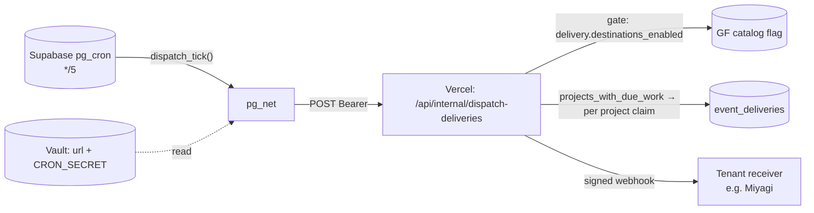

# Pitch — Delivery back on: a dispatch schedule the free Vercel plan allows

Moves · Tests: not grounded — no strategy yet. Why: keeps event delivery working (the poster says "delivery LIVE in
production"; it has not delivered since 2026-07-22).

## The ask, as given

> Does event delivery come back, and what calls the existing `CRON_SECRET`-gated route
> (`/api/internal/dispatch-deliveries`) every few minutes on the free plan?

_(Reconstructed from verify-spike finding F7 on 2026-10-14; refined on 2026-10-17 from "Refine the delivery-back-on
idea".)_

### Claims
1. Event delivery comes back on in production.
2. Something calls `/api/internal/dispatch-deliveries` every few minutes, and it works on Vercel's free plan.
3. The route stays the one registered caller of `projects_with_due_work()`; only the thing that wakes it changes.
4. We decide what happens to the backlog of pending deliveries (send or expire) before switching on.

**Teach-back:** <yes | partly | no> — "You want webhooks delivered within minutes again, woken by something the free
Vercel plan allows, without touching the scheduler exemption. Right?"

## Problem

A tenant who creates a destination gets nothing. Since 2026-07-22 no delivery attempt has run in production: there are
about 320 pending rows (2026-10-14 read), the gate `delivery.destinations_enabled` is off, and `vercel crons ls` lists no
cron jobs. There are two causes, and both have to be fixed:

1. **The schedule isn't registered.** The `*/5` cron lives only in `apps/web/vercel.json`. The project's Root Directory
   is `.`, so Vercel reads the repo-root `vercel.json`, which has no `crons`.
2. **The free plan can't hold it anyway.** Vercel's current docs (checked 2026-10-17): Hobby cron jobs run *at most once
   per day*, with ±59 min precision, and "cron expressions that would run more frequently will fail during deployment."
   Moving the entry to the root file would break every deploy.

A webhook delivered a day late isn't delivery.

## Appetite

**S.** The waker and the backlog decision are worth one session, no more. The dispatcher, claim, retry, dead-letter and
replay all exist and are tested; this bet adds no delivery logic.

quote: $8–20 (S, n=12, p25–p75)

## Outcome & signal

Within five minutes of an event landing for a project with an enabled destination, an attempt row exists for it, and
`cron.job_run_details` shows a `succeeded` run every five minutes. Daniel can check it by reading `delivery_health` for
`miyagisanchez` and seeing `last attempt` in the last 5 minutes.

## Stage-2.5 bucket

**Light enhancement.** Delivery is fully built. What's missing is a scheduler and an operational switch-on. No new route
and no new delivery code.

## Bill of materials (What / Why)

| What | Why |
|---|---|
| `pg_cron` + `pg_net` on our Supabase, a `*/5` job that POSTs the route | minute-level on the free plan, on the database we already run; no new service |
| `dispatch_tick()` SQL function: reads the URL + bearer from Supabase Vault, no-ops if either is missing | the secret never sits in a migration or a job row; the tick fails closed like the route |
| keep `*/5`, not every minute | the route's 240 s tick budget is sized so ticks never overlap at 5 min |
| delete `apps/web/vercel.json`'s dead `crons` | it is the config that made F7 look fine; one waker, said once |
| a backlog decision, applied once before the flip | 320 rows go out on the first tick otherwise |
| activation runbook, owed to Daniel | Vault secret, receiver check, flag on: prod writes, in the order that kept 2026-07-22 safe |

## Scope

**In v1:** the migration (extensions, `dispatch_tick()`, the schedule, grants); removing the dead Vercel cron; the
backlog step; the doc lines (AGENTS registry *Caller* column, the route's header comment, the poster's F7 line); the
activation runbook; the prod switch-on with Daniel.

**Out of v1 (no-gos):**
- Upgrading to Vercel Pro. It's a money decision, and the option stays open (decision a).
- Any change to `projects_with_due_work()`, the claim, retry or dead-letter logic, or the exemption's six conditions.
- Alerting when the waker goes silent again. That would be a follow-up idea; v1's signal is the smoke read.
- A GitHub Actions schedule. Scheduled runs are delayed under load and can be dropped, the same failure class as F7.
- Per-minute dispatch, or moving the scheduler to an external service.

## Rabbit holes

- **pg_net's default timeout is 5 s; the route can run 240 s.** Set `timeout_milliseconds` above the route's
  `maxDuration` (300 s), then confirm on a real tick that a long request isn't cancelled when pg_net gives up. If it
  is, the route answers fast and continues with Next's `after()`. Decide that by measuring, not by reading.
- **The scheduler exemption.** Condition 1 ("runs only from a platform scheduler") and condition 4 (`CRON_SECRET`, fail
  closed) still hold: pg_cron is a platform scheduler and sends the same bearer. The registry row keeps its function
  and its caller; only the *Caller* note gains "woken by pg_cron". If a builder finds a reason the waker needs more
  than that note, stop and ask Daniel (AGENTS: a comment cannot amend the rule).
- **Two copies of `CRON_SECRET`** (Vercel env + Vault). Rotation must touch both. The runbook says so, and a mismatch
  shows as `401` in `net._http_response`, never a silent pass.
- **Local and CI databases.** The migration must apply cleanly where Vault holds no secret. The schedule exists there,
  but each tick no-ops. Don't seed a secret in CI.
- **The receiver may have moved since July.** Before the flip, re-check Miyagi's receiver with the differing-401-body
  probe (memory: event-destination-router runbook). A `401` is a permanent 4xx, so a missing receiver secret would
  dead-letter the whole backlog.

## What already exists (reuse, don't rebuild)

- `apps/web/app/api/internal/dispatch-deliveries/route.ts`: `CRON_SECRET` bearer (fail closed, constant-time),
  gate check, per-project budgets, accepts GET and POST.
- `apps/web/lib/delivery-dispatch.ts` (`dispatchPendingDeliveries`), `lib/deliveries.ts` (`projectsWithDueWork`,
  `replayDelivery`, `getDeliveryHealth`).
- `projects_with_due_work()` (`20260724100000_delivery_retry.sql`), the exemption's one registry row.
- `claim_deliveries` after #373 (`20261016100000`): stale reclaim counted and logged, the F2 fix this bet waited on.
- Status `dead` + `last_error` (`20260722110000_delivery_outbox.sql`). Operator replay moves `dead → pending`, so
  expiring the backlog is reversible per row.
- The gate `delivery.destinations_enabled` (`lib/gates-decision.ts`), the kill switch already in place.
- The `delivery_health` view (`20260725100000_delivery_health.sql`), the smoke's read.

## Visuals



## UX heuristics & rails check
- **CI guards covering this surface:** the exemption's function-level-denial spec on `projects_with_due_work()`; the
  delivery timing guard (`lib/delivery-timing.test.ts`); `gates-guard.test.ts` (no new `*_ENABLED` env read); the
  semantic-lint `tenancy` rule.
- **Audits-lens findings that apply:** verify-spike F7 (this) and F2 (fixed, #373).
- **Design-language debt:** none. No UI.

## Kill-switch / runtime gate (Stage 6b)

**Measure: carve-out.** This is a Bug restoring promised behaviour, so there is no adoption bet to read. **Safety:
reuse.** `delivery.destinations_enabled` is already the kill switch (`frijoles flags kill delivery.destinations_enabled
--env production`) and the route and dispatcher both check it. No new flag. The pg_cron job is the second, independent
off switch (`cron.unschedule`).

## Acceptance criteria

**S1.1: a minute-level waker on the database (high).**
- A migration enables `pg_cron` and `pg_net`, creates `dispatch_tick()`, and schedules it `*/5`.
- `dispatch_tick()` reads the URL and bearer from Vault. With either one missing, it sends nothing and returns.
- `REVOKE ALL … FROM PUBLIC, anon, authenticated; GRANT EXECUTE … TO service_role`, pinned by a spec that asserts a
  function-level denial (the exemption's condition-3 pattern).
- A spec: with no Vault secret, a tick enqueues no `net.http_request`.
- `apps/web/vercel.json`'s `crons` entry is removed. The route's header comment and the AGENTS registry *Caller* note
  name the pg_cron waker.

**S1.2: the backlog, decided before the flip (high).**
- Per decision b: expired rows become `dead` with `last_error = 'expired: delivery was off 2026-07-22 → <date>'`,
  applied once, idempotent, and scoped to `status = 'pending' AND created_at < <the activation cutoff>`. Or nothing
  changes and the runbook says they will send.
- `delivery_health` shows the result per project before the flip.

**S1.3: switch-on, with Daniel (high, prod: owed to Daniel by name).**
- The runbook, in this order: Vault secrets set → manual `select dispatch_tick()` while the flag is off returns
  `{"enabled":false}` with `200` in `net._http_response` (proves URL + secret) → receiver check → flag on → watch two
  ticks.
- Two consecutive scheduled ticks succeed, and a fresh event for `miyagisanchez` gets an attempt row within 5 minutes.
- The poster's F7 "owed" line is cleared.

**Smoke walkthrough** (owed to Daniel, signed in): open the `miyagisanchez` destinations page, confirm that *last
attempt* is less than 5 minutes old, send one test event, and see its attempt appear.

## Open risks / research

- Vercel Hobby crons: once a day, ±59 min, more frequent expressions fail the deploy —
  https://vercel.com/docs/cron-jobs/usage-and-pricing (read 2026-10-17).
- Supabase Cron runs "every second to once a year" and can make HTTP requests —
  https://supabase.com/docs/guides/cron. That page doesn't state plan availability. The builder confirms `pg_cron` and
  `pg_net` appear in prod's `pg_available_extensions` before writing the migration. **Not checked in this session:** the
  prod read was blocked by auto mode.
- The 320 pending count and the gate's `off v1` are from 2026-10-14. Re-read both before S1.2.

## Intent match

_Advisory and uncalibrated (intent-match D1, D3): it can add a step, never block one. Regenerate with `node scripts/intent-match.mjs <this seed> --write`._

```text
Intent match — Roadmap/00-ideas/seeds/delivery-back-on.md
  coverage in   0.94  (4 claims)
  coverage out  0.80  (10 criteria)
  clarity       0.76  (10 criteria)
  teach-back    —     (not recorded)
  agreement     pending  (the optional reader at the architecture lock)
Total 84 / 100 — uncalibrated · signals: coverage in, coverage out, clarity
Band: build (placeholder bands: 80 build · 60 resolve follow-ups · below 60 sketch or spike)
Gaps: none
```

<!-- intent-match: {"coverage_in":0.943,"coverage_out":0.804,"clarity":0.761,"teach_back":null,"total":84} -->
