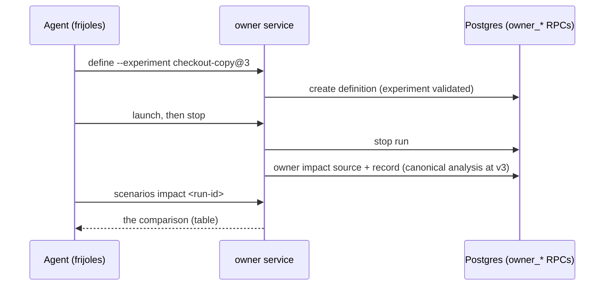

# Pitch — drill impact for agents

Moves · Tests: not grounded (see `grounded_reason`). Tests: Value proposition (agents do the legwork).

## The ask, as given

From `scenarios-light-up` S2.3, 2026-10-13. The production drill ran and stopped cleanly, but the scenarios page's
impact comparison was empty, so the product owner's judgment of it (`scenarios-pm-operable` D11: could it be misread
as a causal customer claim?) could not be made. The ask, as the product owner set it (2026-10-13), agents first and
the page for humans:

> 1. `frijoles scenarios define … --experiment <key>@<version>` binds a drill to an experiment (page: the same choice).
> 2. An owner path to capture impact evidence for a stopped run.
> 3. `frijoles scenarios impact <run-id>` (and `--json`) reads it; the connector's `list_scenarios` names it.
> 4. Then the product owner judges the rendered comparison (D11) on a real drill.

### Claims
1. A drill can be bound to an experiment, from the CLI and the page.
2. An owner (not a Miyagi admin key) can capture a stopped run's impact.
3. Agents read it: the CLI and the connector.
4. The product owner judges the rendered comparison on a real drill.

**Teach-back:** <yes | partly | no> — "You want an agent to bind a drill to an experiment, have its impact captured
when it stops, and read it back from the CLI, so you can finally judge the comparison on a real drill."

## Problem

**Why the comparison was empty** (re-read 2026-10-14):
- Impact is the bound experiment's canonical analysis at its definition version, snapshotted for the run
  (`captureScenarioImpactEvidence`, `lib/scenario-impact-operations.ts`). No experiment, no analysis to snapshot.
- `frijoles scenarios define` (`app/api/v1/cli/scenarios/route.ts`, `define`) builds the definition with no
  `experiment`, and the page's authoring draft has no experiment choice. The SDK supports one
  (`ScenarioDefinition.experiment`).
- Capture exists only as `POST /api/v1/scenarios/impact`, through `get_scenario_impact_source(p_key_hash, …)` and
  `record_scenario_impact_evidence(p_key_hash, …)`: a `flag_admin` key plus a Miyagi user header. No owner path, no
  CLI command.
- The page already renders impact snapshots (`drill-evidence.tsx`). Once evidence exists, there's something to look at.

## Appetite

M: two sprints. Bind and capture, then read and judge.
quote: $15–34 (M, n=24, p25–p75)

## Outcome & signal

An agent defines a drill with `--experiment checkout-copy@3`, launches and stops it, and impact is captured at stop.
`frijoles scenarios impact <run-id>` prints the comparison, the connector's `list_scenarios` says a run has impact,
and the page shows it. Then the product owner makes the D11 call. Signal: impact rows on golden-frijoles.

## Stage-2.5 bucket

Light enhancement. The analysis, the snapshot, the evidence table and the page rendering all exist; what's missing is
the binding and an owner door, exactly as target setup was before `scenarios-light-up` D2/D3.

## Bill of materials (What / Why)

| What | Why |
|---|---|
| `define --experiment <key>@<version>` + the page's choice | no binding, no impact |
| owner RPCs beside `owner_*` (source + record by project and user) | owners, not Miyagi admin keys |
| capture at stop, through `lib/scenario-owner-service.ts` | no forgotten step |
| `frijoles scenarios impact <run-id> [--json]` | agents read it first |
| connector `list_scenarios` names it | an agent knows where to look |
| D11 walkthrough on a real drill | the judgment this was for |

## Scope

**In v1:** the binding on both doors (CLI and page, one builder); two owner RPCs mirroring the key-hash ones
(`p_project_id`, `p_user_id`, membership-checked, service-role only); capture **automatically at stop** for a bound
drill (decision a), with `frijoles scenarios impact <run-id> --capture` to retry a failed one; the CLI read; the
connector field; the D11 judgment.
**Out of v1 (no-gos):** impact for a drill with no experiment (it says "not bound to an experiment", never an empty
chart); security drills from the CLI (still page-only, #348); a chart change (the comparison stays a table, per the
#14 charts rule); retiring the Miyagi key path (it keeps working).

## Rabbit holes

- **Owner RPCs are an authorization boundary.** Copy the `owner_*` pattern exactly: the user must be a member of the
  project, re-checked in SQL, and `REVOKE` from PUBLIC/anon/authenticated. A spec asserts a non-member's call fails
  at the function, not at RLS.
- **The experiment must exist at that version** when the drill is defined, and still match at capture (the existing
  409 on a version mismatch). Validate at define time, so a typo fails early.
- **Capture at stop can fail** (the analysis is unavailable, or a 409). The stop must still succeed; the failure is
  recorded and the `--capture` retry exists for it.
- **D11's question is copy, not code.** The comparison must not read as a causal claim about customers. The
  walkthrough asks it in those words.

## What already exists (reuse, don't rebuild)

- `lib/scenario-impact-operations.ts` (`captureScenarioImpactEvidence`, `getScenarioImpactEvidence`),
  `lib/scenario-impact.ts`, `lib/scenario-impact-link.ts` (`scenarioImpactExperimentReference`).
- `lib/scenario-owner-service.ts` (`ownerDirectOperation`, `launchScenarioRun`), `app/api/v1/cli/scenarios/route.ts`
  (`define`, `launch`, `stop`), `20260813100000_scenario_owner_operations.sql` (the `owner_*` pattern).
- `20260809130000_scenario_impact_evidence.sql` (the two key-hash functions to mirror).
- `packages/sdk/src/scenarios.ts` (`experiment?`), `lib/scenario-authoring-draft.ts`, `lib/mcp-scenario-tools.ts`,
  `app/app/scenarios/[projectSlug]/drill-evidence.tsx`.

## Visuals



## UX heuristics & rails check

- **CI guards covering this surface:** the scenario api specs, the function-level-denial specs, the scenario authoring
  switch (404 before credentials), semantic-lint `tenancy`.
- **Audits-lens findings that apply:** none found.
- **Design-language debt:** none (the page's experiment choice reuses the authoring form's controls).

## Kill-switch / runtime gate

**None: carve-out.** Scenario authoring already has its switch (`scenarioAuthoringOn`, a catalog gate): off answers
404 on the CLI and the page before credentials. Measuring adoption isn't the point here: the outcome is one judgment
(D11) and the evidence count.

## Acceptance criteria

**Sprint 1: bind and capture**
- **S1.1** (low): `frijoles scenarios define … --experiment <key>@<version>` and the page's experiment choice bind a
  drill; an unknown key or version is refused at define time, naming it.
- **S1.2** (high): owner RPCs `owner_get_scenario_impact_source` and `owner_record_scenario_impact_evidence`
  (membership re-checked, service-role only, function-level denial spec for a non-member and for anon).
- **S1.3** (high): stopping a bound drill captures impact through the owner service; a failed capture doesn't fail the
  stop and is retried by `--capture`.

**Sprint 2: read and judge**
- **S2.1** (low): `frijoles scenarios impact <run-id> [--json]` prints the comparison, or "not bound to an
  experiment" / "not captured yet".
- **S2.2** (low): the connector's `list_scenarios` names each run's impact state; the CLI release is owed to the
  product owner (npm).
- **S2.3** (judgment, the product owner): D11 on a real drill on goldenfrijoles.com, written into
  `scenarios-pm-operable`'s decisions.

## Open risks / research

- Decided 2026-10-14 (Daniel): capture automatically at stop (a); target 0 → 2 stopped drills with impact, read 30 days after shipping (b).

## Intent match

_Advisory and uncalibrated (intent-match D1, D3): it can add a step, never block one. Regenerate with `node scripts/intent-match.mjs <this seed> --write`._

```text
Intent match — Roadmap/00-ideas/seeds/drill-impact-for-agents.md
  coverage in   0.96  (4 claims)
  coverage out  0.91  (6 criteria)
  clarity       0.78  (6 criteria)
  teach-back    —     (not recorded)
  agreement     pending  (the optional reader at the architecture lock)
  why story     0.30  (advisory, not in the total: rewrite the Why as a story)
Total 88 / 100 — uncalibrated · signals: coverage in, coverage out, clarity
Band: build (placeholder bands: 80 build · 60 resolve follow-ups · below 60 sketch or spike)
Gaps: none
```

<!-- intent-match: {"coverage_in":0.962,"coverage_out":0.905,"clarity":0.777,"teach_back":null,"total":88} -->
