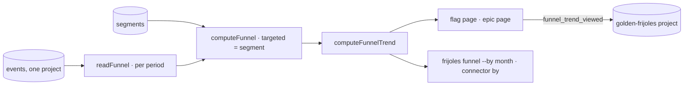

# Pitch — funnel truth

Moves · Tests: not grounded (see `grounded_reason`). Tests: Value proposition, knowing with evidence which build spend
produced results.

**Consolidated 2026-10-14** from [`tars-segments`](tars-segments.md) and [`funnel-trend`](funnel-trend.md), now
archived. **Re-read against the code 2026-10-14:** `tars-one-model` already did tars-segments item 2. Every funnel,
including the registry funnels in `lib/tars-query.ts`, reads through the one model (`computeFunnel`,
`lib/flag-funnel.ts`), and Satisfied already exists as an optional event. What's left is below.

## The ask, as given

> If i launch a feature thats flagged and measured through tars, i should be able to measure its performance across
> time. This means that if i want to check how the features performed over the last year i should.
> — Daniel, 2026-10-12

And from one-bet-wired's Plan gate (Daniel, 2026-10-10, recorded in `tars-segments`): Targeted is the share of the
user base that has the problem, a strategy decision, not who was exposed.

### Claims
1. A flagged, measured feature's funnel can be read across time.
2. Back as far as a year (its whole life).
3. Targeted can be a named segment, not only everyone.

**Teach-back:** <yes | partly | no> — "You want to see a feature's funnel as a line over its life, by when people
first got it, and to aim a bet at a named segment, so you can tell whether it is getting better for the people it
was meant for."

## Problem

A funnel today is one set of numbers for a period (`all`, `90d`, `30d`): who was first exposed in it, how many
adopted, retained and were satisfied. A founder can't see whether adoption is improving month over month. Targeted is
always `everyone` (`computeFunnel`: `const targeted = base`), and the push schema refuses any other segment
(`roadmap-artifact-schema.ts:203`). Viewing a funnel emits no event, so Golden Frijoles can't measure its own funnel
feature, and the flag funnel's switch (`bets.flag_funnels_enabled`) has no rendered on/off spec.

## Appetite

L: two sprints. The trend first (the verbatim ask), then segments.
quote: $49–68 (L, n=7, p25–p75)

## Outcome & signal

On a flag's page, an epic's page and through the CLI and connector, a member sees the funnel's stages by the month (or
week) people were first exposed, back to the first exposure. A bet can name a segment; its Targeted is that segment's
share of the base, Adopted is counted within it, and adopters outside it show beside the funnel. Signal:
`funnel_trend_viewed`.

## Stage-2.5 bucket

Light enhancement on a finished model: the trend is `computeFunnel` run per cohort period; the segment replaces one
line (`targeted = base`). New: a segment definition and where it lives.

## Bill of materials (What / Why)

| What | Why |
|---|---|
| `computeFunnelTrend`: cohorts by first-exposure month/week | the line, from the one model |
| a bounded read for a year, honest at the row cap | a year of events can pass 50,000 rows |
| trend on the flag page + epic page (`SmallMultiple`/`Plot`) | where a founder already reads a funnel |
| `frijoles funnel <key> --by month` + connector `by` | agents read it first (CLI-first) |
| `funnel_trend_viewed` on every funnel view | Golden Frijoles measures its own funnel |
| segment definitions per project (migration) | a named segment needs a home |
| Targeted = the segment; adopters outside, beside | Daniel's TARS model |
| push accepts a segment key | a bet names its segment |
| browser spec, funnel switch on and off | the gap one-bet-wired's retro left |

## Scope

**In v1:** everything in the table. A segment is a **behaviour** rule: people who did event X at least N times in the
last D days (decision a). Segments are defined from the CLI and listed in the console with their share of the base.
**Out of v1 (no-gos):** a Satisfied *ask* (a rating or survey the product shows: an SDK and UI project of its own,
re-seeded as `satisfied-ask`); tag-based segments (decision a); Journeys cohorts as segments; any change to
`everyone` bets' numbers (they compute exactly as today); a chart dependency (`design-system/charts` only).

## Rabbit holes

- **The row cap.** `readFunnel` caps at `FLAG_FUNNEL_ROW_CAP = 50_000` rows. A year-long trend for a busy flag passes
  it. Read per period, or aggregate in SQL. Whichever you pick, a period the read couldn't finish says so in words
  (`ChartUnreadable`), never as a short bar.
- **The young cohort.** The current month's cohort hasn't had `retention_days` to retain yet. Mark it "still
  maturing", not a drop.
- **No number changes under `everyone`.** Segments change Targeted only for a bet that names one, so existing reads
  don't move. A spec pins `everyone` to today's output.
- **Segment share needs the base.** Targeted = the segment's members within the period's active people (the `base`
  read `readFunnel` already does). Never the segment's all-time size.
- **The tenancy rule.** Every read stays one project; segment definitions are per project, with no cross-project
  segment.

## What already exists (reuse, don't rebuild)

- `lib/flag-funnel.ts` (`computeFunnel`, `since`, `FUNNEL_PERIODS`), `lib/flag-funnel-read.ts` (`readFunnel`, the row
  cap, the base read), `lib/tars-query.ts` (registry funnels through the same model).
- Screens: `app/app/flags/[projectSlug]/[flagKey]/` (`feature-panes.tsx`), the Hub epic page, `app/app/funnel/…`.
- `design-system/charts`: `SmallMultiple`, `Plot`, `StageBars`, `ChartUnreadable`, `seriesAbsence`.
- Connector `get_tars_funnel` (`app/api/v1/public/mcp/c/[token]/route.ts`), `packages/cli` (`bet.ts`; a `funnel` read
  is new), `lib/self-track.ts`.
- Push: `lib/roadmap-artifact-schema.ts` (`target_segment` enum).

## Visuals



| cohort (first exposed) | exposed | adopted | retained (7 d) |
|---|---|---|---|
| 2026-08 | 412 | 131 (32%) | 70 (53%) |
| 2026-09 | 530 | 196 (37%) | 112 (57%) |
| 2026-10 | 188 | 61 (32%) | still maturing |

## UX heuristics & rails check

- **CI guards covering this surface:** design-system drift/ratchet (charts are kit components), the `api` funnel
  specs, semantic-lint `tenancy`, the gates guard (rule #6).
- **Audits-lens findings that apply:** app-ux-audit §2.3 (no visualisation), closed by `design-system/charts`.
- **Design-language debt:** none expected.

## Kill-switch / runtime gate

Measure: `bets.funnel_trend_enabled`, enablement, **off until you roll it out**, measured by `funnel_trend_viewed`.
Off: the pages read as today. Segments ride the same flag on screen; the CLI reads aren't flag-gated (agents first).

## Acceptance criteria

**Sprint 1: the trend**
- **S1.1** (low): `computeFunnelTrend(events, rule, measure, { by: 'month' | 'week' })` returns one funnel per cohort
  period back to the first exposure, from `computeFunnel` with a `since` and `until`; pure specs, including the
  maturing cohort.
- **S1.2** (high): the read covers the whole life within a bound; a period cut by the cap is marked unreadable, never
  undercounted (api spec seeding past a small cap).
- **S1.3** (low): the flag page and the epic page show the trend (`SmallMultiple`, one line per stage) behind
  `bets.funnel_trend_enabled`; `funnel_trend_viewed` fires once per view; browser spec on and off, which also closes
  the `bets.flag_funnels_enabled` on/off gap.
- **S1.4** (low): `frijoles funnel <key> --by month [--json]` (member-gated, PAT) and the connector's
  `get_tars_funnel` `by` parameter return the same rows.

**Sprint 2: segments**
- **S2.1** (high): a migration adds per-project segment definitions (key, event, min count, days), service-role only;
  `frijoles segments define|ls` writes and reads them.
- **S2.2** (high): a bet naming a segment computes Targeted within it, Adopted within it, and adopters outside it
  beside the funnel; `everyone` is byte-identical to today (pinned spec).
- **S2.3** (low): the push accepts `target_segment: <key>` (a key the project defines, or `everyone`).
- **S2.4** (low): the console lists segments with their share of the base, and the funnel names its segment.

## Open risks / research

- Decided 2026-10-14 (Daniel): segments by behaviour (a); target 0 → 3 members opening a trend, read 30 days after shipping (b).

## Intent match

_Advisory and uncalibrated (intent-match D1, D3): it can add a step, never block one. Regenerate with `node scripts/intent-match.mjs <this seed> --write`._

```text
Intent match — Roadmap/00-ideas/seeds/funnel-truth.md
  coverage in   0.94  (3 claims)
  coverage out  0.85  (8 criteria)
  clarity       0.75  (8 criteria)
  teach-back    —     (not recorded)
  agreement     pending  (the optional reader at the architecture lock)
  why story     0.62  (advisory, not in the total)
Total 84 / 100 — uncalibrated · signals: coverage in, coverage out, clarity
Band: build (placeholder bands: 80 build · 60 resolve follow-ups · below 60 sketch or spike)
Gaps: none
```

<!-- intent-match: {"coverage_in":0.937,"coverage_out":0.845,"clarity":0.75,"teach_back":null,"total":84} -->
