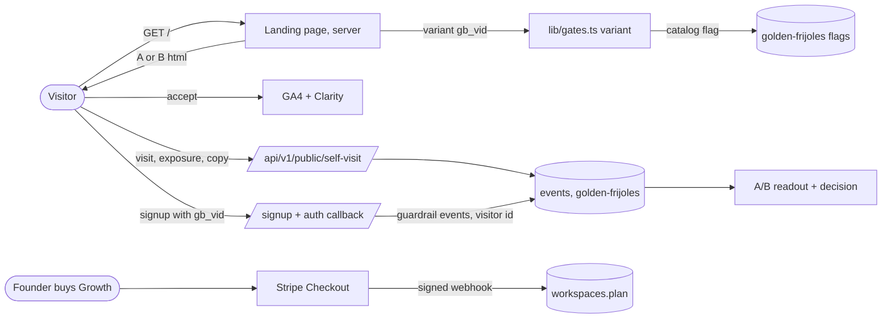
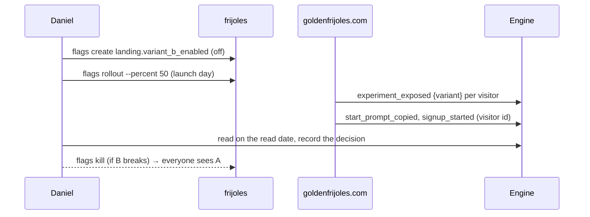

# Pitch — Launch: the first landing A/B on goldenfrijoles.com, run on Golden Frijoles

Moves: proving_workspaces · Tests: Value proposition (the highest domino in `risk-validation.md`). The landing is the
only way a new workspace arrives, so breadth starts here; B's "did they pay off?" is the North Star's proven bet.

## The ask, as given

> it is time to launch the product and id like to run a Landing page experiment using our engine of course all the way through.
> Id like to iterate the landing page communication towards my following outline, and polish and restructure the current one so we can actually run the experiment side by side, heres what i want to try:
> Change the overall communication and copy towards:
> Ship work that matters (Hero, and lets make the hero a single column with header, subheader and copy paste prompt to get started)
> thousands of prs per second, but did they pay off? (suheading)
> Features - (lets find a better name to weave that section in)
> Keep context of why anything is being built at all times - marketing shots of the claude mod, hub or epic view. I want to highlight the why, targets, hypothesis as that is core to a product practice.
> Track and analyse every feature you launch as per our analytics frameworks - marketing shots of TARS, Northstar and its inputs. am i missing anything valuable here?
> Manage your agents cost, understand cost of opportunity vs expected payout. Make decisions informed. - Outcome report marketing shots
> Simulate scenarios:
> 	- Get your product ready for launches, events, campaigns
> 	- Start a mutiny. Let your agent plan and deploy a drill that will destroy your system.
> Have multiple ideas worth exploring? Launch ab tests with your agent
> Launching an experimental feature you want to release only to a cohort of users? Use our feature flags to manage.
>
> In addition lets do a sanity check pre launch.
> For starters:
> We need to install GA either via GTM or else and Microsoft clarity on the site. I think Clarity has an mcp if you can set it up all the way lets do it and GA i can get the details needed, but nothing is created on google yet i believe for this property.
>
> As you may imagine i need to see mockups/prototypes for the work that requires design (landing pages). This is also the first time doing an experiment on goldenfrijoles.com using golden-frijoles so as you drive lets document gaps and improvements for other agents.
>
> […] the self serve route pricing and business model or maybe just the implementation should be rethought and actually setup stripe.
> […] My account (daniel@despachobonsai.com) currently can have unlimited products, but mine is an admin. We should just flag it like that and have it granted this type of access. That way we could leave the free tier as is and the bespoke one to hire me and go do it for them, the white glove approach i mean. […] Or should we wire stripe to the 49 usd one, the growth tier already?
>
> (2026-10-19, after the prototype rounds) B is approved. Refine the seed into an epic with the five slices, starting with instruments and the experiment rail.

### Claims
1. Run a landing A/B on goldenfrijoles.com through Golden Frijoles, end to end, A and B side by side.
2. B follows the outline: single-column hero (header, subheader, copy-paste prompt), a renamed features section with
   product shots for why / measure / cost / rehearse / A/B / flags.
3. Install GA4 and Microsoft Clarity before launch; Clarity's MCP set up all the way.
4. Document the gaps and improvements found by dogfooding, for other agents.
5. Set up Stripe on the $49 Growth tier; leave the free tier as is.
6. Daniel's own account gets unlimited products as a granted plan, not an admin bypass.
7. A white-glove "hire me to do it" offer, reached from the product.
8. Five slices, in order, starting with instruments and the experiment rail.

**Teach-back:** yes — "You want to launch with B tested against A on our own engine, with analytics, billing and the
white-glove offer in place, so the launch tells you which story makes founders start. Right?" (B approved after three
prototype rounds, 2026-10-19.)

## Problem

goldenfrijoles.com is about to get its first real traffic and cannot tell us anything about it. The landing funnel
(`waitlist_conversion`) still counts waitlist joins, a CTA signup replaced, so it reads 0 forever. A visit is recorded
under the visitor cookie and a signup under the new user id, so no page change can be read against signups. There is
no GA or Clarity, so we cannot see where people come from or where they stop. The pricing card says "nobody can be
charged this today", which tells every visitor the business is not real yet. And the one paid path that exists, Daniel
setting it up with a team, is a Pods card with no shape.

## Appetite

**L** — a multi-wave epic, re-bet at each wave boundary (WAYS-OF-WORKING → *Betting & appetite*).
quote: $41–62 (L, n=8, p25–p75)

Wave 1 = S1 + S2 (the experiment can start on A alone). Wave 2 = S3 (B, which starts the test). Wave 3 = S4 + S5
(independent of each other and of the test).

## Target — a best guess, grounded in the GTM activity plan (Daniel, 2026-10-19)

Daniel: "you are going to have to come up with some targets … this would have to be grounded by gtm activities, since we
dont really have a plan yet, lets do best guess i think for now." Every number below is an assumption; re-set the target
when a GTM plan exists.

| Step (launch ~late Oct → 31 Dec) | Assumed | Basis |
|---|---|---|
| Landing visitors | ~2,000 | launch posts (LinkedIn, HN/Product Hunt) ~1,000 + ~15/day from weekly posts and outreach; today ~8/day |
| Copy the start prompt | ~8% → ~160 | typical hero-CTA rate for a dev tool; S1 measures A's real baseline |
| Workspace created (installed + signed in) | ~25% → ~40 | the prompt asks the agent to read and wait for a go-ahead, so drop-off is high |
| First bet placed with a read date | ~30% → ~12 | setup ends in a first bet |
| Proven by the read date | ~25% → **~3** | a bet needs its own read date (30 days by default) inside the window |
| Set up with us sessions | **~2** | GTM playbook's day-30 gate (1 signed) plus one more by day 60; each session ends in a proven bet |

**Target: 0 → 5 proving workspaces acquired through the landing, counted in December 2026** (`proving_workspaces` is
distinct per calendar month). B is the better page if, on top of winning prompt copies at day 21, B-acquired workspaces
prove at least as many bets as A-acquired ones.

## Outcome & signal

- Every landing visitor is counted once, in one variant, with the prompt copy and the signup on the same id.
- The A/B readout on `/app` shows A vs B on `start_prompt_copied` with a confidence range, and signups as a guardrail.
- `frijoles flags kill landing.variant_b_enabled --env production` returns everyone to A within the gate cache (30 s).
- GA4 realtime and Clarity recordings show the site after a visitor accepts the consent banner, and nothing before.
- A Growth workspace can be bought, cancelled and comped. Daniel's workspace is comped.
- `/talk` sells "Set up with us" with what it is, what you leave with and the price.

## Stage-2.5 bucket

**Genuinely new, built mostly from parts that exist.** The engine already buckets by targeting key, records exposures,
reads A/B with intervals, registers experiments with guardrails and a sample size, and kills a flag from the CLI. What
is new is our own site using it: a per-visitor variant read, a copy event, an identity join, B itself, consent + tags,
and billing.

## Bill of materials (What / Why)

| What | Why |
|---|---|
| Consent banner, deny by default | GA4 and Clarity need consent for EU/UK visitors |
| GA4 + Clarity behind consent | See sources and where people stop; Clarity's MCP lets an agent read it |
| Visitor → user join | The only way any landing change is read against signups |
| Landing funnel retargeted | The current one measures a removed CTA and reads 0 |
| `variant()` beside `gate()` | Our own site reads a per-visitor variant through the one gate seam |
| `start_prompt_copied` on the beacon | The hero's only action; frequent enough to read at our traffic |
| `landing.variant_b_enabled` + experiment | 50/50 split, read date, decision record, kill switch |
| Variant B page | The story under test; A stays byte-identical |
| `workspaces.plan` + workspace event pool | Price per workspace, meter events; comped plan replaces an admin bypass |
| Stripe Checkout + webhook + portal | The first real willingness-to-pay signal |
| `/talk` → Set up with us | The white-glove offer gets a page with a shape and a price |

## Scope

**In v1:** the 18 stories below.

**Out of v1 (no-gos):**
- Usage or overage billing, annual plans, coupons, tax automation. Over the pool → we email; we never bill overage.
- Google Tag Manager. GA4 loads directly; GTM only when a non-engineer needs to add tags.
- Any change to variant A beyond the beacon events (A is the control).
- More than two variants, or a second experiment on `/` at the same time.
- A global admin role or anything that reads across workspaces (tenancy invariant).
- New CLI verbs (`frijoles funnel`, `frijoles experiments readout`): logged as gaps, own seed.
- Consulting rates or the consulting strategy in this repo (public-monorepo D7). The résumé hook change happens in
  `miyagisanchez-resume`, not here.

## Rabbit holes

1. **Identity join.** The engine has no alias table (SDK 1.0: events before `identify` stay on the anonymous id). Do
   not build an alias table. The A/B join is by `user_id` (`lib/ab.ts`), so the guardrail events must also be written
   under the **visitor id**: carry `gb_vid` through signup and confirmation, and send the guardrail event keyed on the
   visitor while the activation funnel keeps the user id. Decide which events go where in S1.2 and write it in the epic
   README; this is an auth path (escalate trigger).
2. **One denominator.** The bound-experiment path already writes `experiment_exposed` (SDK `index.ts:655–704`); the
   flag funnel reads `trackFlagEvaluation`. Use the SDK's bound path once, never hand-write a second exposure.
   `experiment_exposed` must carry `feature_id = <experiment key>` (`lib/ab-query.ts:63`), and `start_prompt_copied`
   must NOT need one (LEARNINGS: a filter on a tag the realistic caller doesn't set reads an honest-looking zero).
3. **Our own quota.** The self project's rate and quota carry the landing, signup and every new event (LEARNINGS,
   proving-workspaces-reading). Raise `projects.monthly_event_quota` / `ingest_rate_per_min` for `golden-frijoles`
   before launch day (a data `UPDATE`, never a deploy), and send at most visit + exposure + copy per visitor.
4. **Flicker and caching.** Evaluate on the server; `/` stays `force-dynamic` (page.tsx says why). No client-side swap.
5. **Bots.** Rate-limited beacon is in place; exclude obvious bot user agents from exposure, or the denominator lies.
6. **Consent vs our beacon.** The first-party beacon carries no third-party cookie and stays outside consent; GA4 and
   Clarity load only after accept. Clarity needs its consent API call for EEA traffic.
7. **Stripe webhook.** Signed, idempotent on the event id, sets the plan on ONE workspace resolved from the Checkout
   session's server-side metadata, never from the request body. Money + migration + tenancy: never delegated.
8. **Event pool migration.** Moving the quota from product to workspace must not lower any existing project's
   ceiling. Expand/contract.

## What already exists (reuse, don't rebuild)

- `packages/sdk/src/flags.ts → evaluateFlag` (rollouts by targeting key) and the SDK's bound-experiment exposure.
- `apps/web/lib/gates.ts → gate()` and `lib/gates-decision.ts → GATES` (rule #6: one seam, catalog flags, 30 s cache).
- `apps/web/lib/ab.ts`, `lib/ab-query.ts`, `lib/experiment-*.ts` (experiments-for-humans: builder, intervals, guardrails,
  sample size, decision record) and `frijoles experiments decision`.
- `apps/web/app/api/v1/public/self-visit/route.ts` (fixed event list, rate limit, `gb_vid`), `lib/self-track.ts`,
  `lib/self-track-events.ts` (`EVENT_FEATURE` map).
- `apps/web/components/landing/*` (A, untouched), `CopyPromptCard`, `lib/install-prompt.ts`, `brand/tokens.css`.
- `apps/web/lib/provisioning.ts` (product cap), `workspaces.product_limit`, `lib/quota.ts`, migration `20261015100000`.
- `apps/web/lib/webhook-signature.ts` (constant-time verify pattern), `lib/rate-limit.ts`, `lib/site-url.ts` (rule #5).
- `apps/web/app/talk/page.tsx`, `lib/booking.ts` (Cal.com embed).
- The approved prototype of B: https://claude.ai/artifact/NSTtdQkusMa7YmX6Hfs6RS (v3). Plan memo:
  https://claude.ai/artifact/NS5Hwpfbg4LsfiKDg8Kf1V.

## Visuals





| visitor (gb_vid) | variant | events |
|---|---|---|
| 3f9c…a1 | b | landing_visited · experiment_exposed · start_prompt_copied · signup_started |
| 77de…0c | a | landing_visited · experiment_exposed |
| c210…9e | a | landing_visited · experiment_exposed · start_prompt_copied |

## UX heuristics & rails check
- **CI guards covering this surface:** `scripts/check-design-drift.mjs` (headline rules), `lib/gates-guard.test.ts`
  (no `process.env.*_ENABLED`), `e2e/landing-prompts.spec.ts`, the mobile route sweep, `scripts/check-brand-host.mjs`.
- **Audits-lens findings that apply:** CODE-QUALITY #9 (every public claim checkable): B's product shots are
  screenshots of the public golden-frijoles project, never invented numbers; "per second" became "a day".
- **Design-language debt:** B adds one page; it uses `brand/tokens.css` and the design-system primitives, no raw hex.

## Flag (Stage 6b)
Measure **and** Safety, one flag: `landing.variant_b_enabled`, enablement, catalog `golden-frijoles`, all environments,
created **off** (`frijoles flags get` must print `off vN`). Off = A, on = B. Rolled out to 50% on launch day.
Read through the new `variant()` beside `gate()` (S2.1), with the visitor id as subject. Kill = everyone back to A.
S4's checkout ships behind its own kill switch `billing.checkout_enabled` (on, so it can be switched off), a `GATES` row.

## Acceptance criteria — the stories

### Sprint 1 — Instruments
- **S1.1 Consent + GA4 + Clarity** (risk: medium · orchestrator). A banner, deny by default; GA4 (`@next/third-parties`)
  and Clarity load only after accept, with Clarity's consent call; IDs are public env vars (not gates). Declining loads
  neither (network tab shows no request to either). A CSP allow-list ships with them.
- **S1.2 Visitor → user join** (risk: high · orchestrator). `gb_vid` reaches signup and the auth callback; the guardrail
  events are written under the visitor id; the activation funnel is unchanged. The workspace created for that person
  records its **acquisition variant** (`a` | `b` | none), and `workspace_proved_bet` carries it, so the North Star read
  splits by variant and our own workspaces (no variant) never count. A spec signs up a visitor and reads all three.
- **S1.3 Landing funnel retargeted** (risk: low · Sonnet). `landing_visited → start_prompt_copied → signup_started` on
  the self project; one e2e produces a NON-zero number (LEARNINGS). `waitlist_conversion` retired.
- **S1.4 Instruments verified** (risk: low · orchestrator). Clarity MCP answers a query about the site; GA4 realtime
  shows a visit; the self project's quota and rate raised for launch. Owed by Daniel: GA4 property, Clarity project.

### Sprint 2 — Experiment rail
- **S2.1 `variant()` seam** (risk: high, shared seam · orchestrator, first). Beside `gate()` in `lib/gates.ts`, through
  the same catalog and cache; evaluates with the visitor id as targeting key; same visitor, same variant; reports one
  exposure through the SDK's bound path with `feature_id` = the experiment key. Pure-logic spec on bucketing stability.
- **S2.2 Copy + exposure events** (risk: low · Sonnet). `start_prompt_copied` added to the beacon's fixed list;
  `CopyPromptCard` sends it on both A and B; no caller-named events; bot UAs get no exposure.
- **S2.3 Flag + experiment registered** (risk: low · orchestrator, prod writes). Flag created off in all envs; the
  experiment registered through the builder: metric `start_prompt_copied` (increase), guardrails `signup_started`,
  `account_confirmed`, sample ~880 per variant, read date set on launch day; bound to the flag.
- **S2.4 Dogfood fix: unknown period** (risk: low · Sonnet). `period=7d` returns a 400 naming the accepted values instead
  of silently reading all-time (`lib/flag-funnel.ts:69`).

### Sprint 3 — Variant B
- **S3.1 Hero + nav** (risk: low · Sonnet). Single column: "Ship work that matters" · "Thousands of PRs a day. Did any
  of them pay off?" · the install prompt card. Matches the prototype.
- **S3.2 "From why to paid off"** (risk: low · Sonnet). Six blocks (Why, Measure, Cost, Rehearse, Decide, Release),
  each with a real screenshot of the public golden-frijoles project; Cost shows spend-vs-quote and result-vs-target as
  separate signals; Rehearse shows a real drill; the flag view in plain language.
- **S3.3 Agent strip, founder note, pricing, closing CTA** (risk: low · Sonnet). Note signed, with the methodology link;
  pricing tiers without subheadings, Growth CTA "Get Growth"; closing prompt CTA "Your next epic could be the one that
  pays off".
- **S3.4 `/` serves A or B** (risk: medium · orchestrator). `variant()` picks the component tree; A's markup unchanged
  (snapshot); kill switch verified in production; `force-dynamic` kept; mobile sweep covers both.

### Sprint 4 — Plans + Stripe
- **S4.1 `workspaces.plan`** (risk: high, migration · orchestrator). `free | growth | comped`, mapping to
  `product_limit` and the event pool; Daniel's workspace set to `comped`; nothing reads it across workspaces.
- **S4.2 Workspace event pool** (risk: high, tenancy · orchestrator). Quota counted per workspace; no existing project's
  ceiling drops (expand/contract); over the pool → an email, never a charge.
- **S4.3 Checkout + webhook + portal** (risk: high, money · orchestrator). Stripe via the Vercel Marketplace
  integration; signed, idempotent webhook sets the plan on the one workspace from server-side metadata; cancel through
  the portal returns it to free at period end; behind `billing.checkout_enabled`.
- **S4.4 Pricing copy, A and B** (risk: low · Sonnet). "No billing rail yet" removed only once S4.3 is live in
  production; Growth CTA goes to Checkout.

### Sprint 5 — White-glove
- **S5.1 `/talk` → Set up with us** (risk: low · Sonnet). What the session is, what you leave with, "from $1,500", the
  booking embed kept at its measured height (LEARNINGS: porting a page means porting its measurements), one link to
  the founder's site.
- **S5.2 Cross-links** (risk: low · Sonnet). B's founder note and third tier point at `/talk`; the résumé change
  (its own hook instead of "Ship work that matters") is a PR in `miyagisanchez-resume`, named in the close-out.

**Smoke walkthroughs:** each sprint closes with one (`references/smoke-walkthrough.md`); S1.4, S3.4's kill switch and
S4.3's real purchase + cancel are owed by Daniel by name.

## Dogfood log — gaps found (for other agents; promote to LEARNINGS at close)

1. **No anonymous → known alias in the engine.** `identify` exists (SDK 1.0); events before it stay on the anonymous id.
   Any customer testing a marketing page against signups hits this. (S1.2 works around it; an alias primitive is a seed.)
2. **Our own gate seam is boolean and context-free.** Fixed by S2.1 for us; the SDK already had it.
3. **No CLI read of a funnel or readout.** Traffic was read by curling `/api/v1/public/funnel`. Own seed.
4. **Unknown `period` silently means all-time.** Fixed by S2.4.
5. **No sample-size / read-date prompt when a flag becomes an experiment** at low traffic. Own seed.
6. **Funnels outlive their CTA.** Nothing warns when an adopted event goes quiet for weeks. Own seed.
7. **Activation funnel reads 70 started / 1 confirmed** — likely the id mismatch in (1). S1.2 checks it.
8. **No billing primitive** to offer our own customers. S4 builds ours; packaging it is a later seed.

## Decisions recorded (Daniel, 2026-10-19)
- S2.4 stays in the epic. "From $1,500" on Set up with us is public.
- GA4 measurement ID `G-BWSJJ7JC9X`; Clarity project `z0boh5dqbe` (both public, they ship in page source).
- `CLARITY_TOKEN` is in the root `.env.local` (gitignored): S1.4 uses it for a project-level Clarity MCP, or Daniel
  updates the claude.ai Clarity connector. The Stripe CLI is installed and signed in (S4.3's local webhook testing).

## Open risks / research
- Traffic: 93 `landing_visited` from 2026-10-08 to 2026-10-19 (~8/day, public funnel route). ~880 per variant detects
  8% → 12% copies at 80% power, α 0.05; ~3,800 per variant for 2% → 3% signups. The test needs launch traffic.
- Clarity has required a consent signal for EEA/UK/CH traffic since 31 Oct 2025 (Clarity consent docs).
- Stripe needs a business entity and payout account in Daniel's name; invoicing US customers from Mexico is a question
  for his accountant before the first charge.
- Clarity MCP is configured in this environment but returns an error (no project yet).

## Intent match

_Advisory and uncalibrated (intent-match D1, D3): it can add a step, never block one. Regenerate with `node scripts/intent-match.mjs <this seed> --write`._

```text
Intent match — Roadmap/00-ideas/seeds/landing-launch-experiment.md
  coverage in   0.92  (8 claims)
  coverage out  0.75  (18 criteria)
  clarity       0.78  (18 criteria)
  teach-back    1.00  (yes)
  agreement     pending  (the optional reader at the architecture lock)
  why story     0.39  (advisory, not in the total: rewrite the Why as a story)
Total 86 / 100 — uncalibrated · signals: coverage in, coverage out, clarity, teach-back
Band: build (placeholder bands: 80 build · 60 resolve follow-ups · below 60 sketch or spike)
Gaps: none
Untraced (trace it to the ask or cut it):
  criterion 3 (0.48): "**S1.3 Landing funnel retargeted** (risk: low · Sonnet). `landing_visited → start_prompt_…"
  criterion 8 (0.25): "**S2.4 Dogfood fix: unknown period** (risk: low · Sonnet). `period=7d` returns a 400 nami…"
  criterion 14 (0.49): "**S4.2 Workspace event pool** (risk: high, tenancy · orchestrator). Quota counted per wor…"
```

<!-- intent-match: {"coverage_in":0.916,"coverage_out":0.752,"clarity":0.78,"teach_back":1,"total":86} -->
