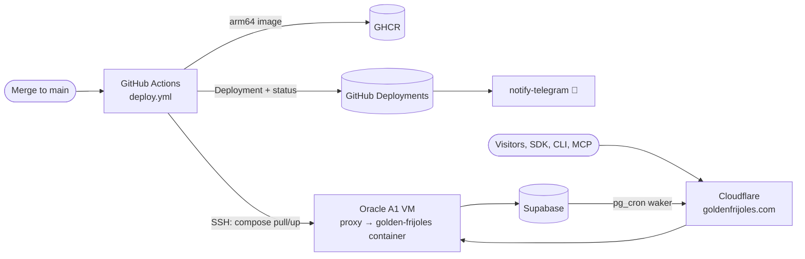

# Pitch — Off Vercel: production on our own box

Moves · Tests: neither — infrastructure. goldenfrijoles.com has returned 402 since 2026-10-30, so every input reads zero
until the product is reachable again; this restores it rather than moving an input.

## The ask, as given

_One redaction: the personal site's Vercel host is written `<deployment>.vercel.app` (the brand-host guard keeps
deployment hosts out of this public repo)._

> hi claude, we recntly hit vercel limits and now this project and all of the rest in vercel are paused for the month. Lets explore how to get them back online. I personally only like vercel for staging deployments and nothing else, in fact if theres an alternative that would get us out of vercel, even better. We have available an oracle vm and a few gcp accounts with billing enabled on which we could leverage their always free tier as well. We are currently on golden-frijoles, but the affected projects are also my personal site <deployment>.vercel.app, despachobonsai.com , not sure what part of miyagisanchez.com is still there in vercel too. I also have another vercel account if just easier to redeploy there. Again, vercel will never be paid, always the free tier, thats why i dont ever want to invest on maintaining projects there or build specifically adapted to the vercel platform. Let me know what you think and options available youd suggest

> so it all makes sense, on your last comment you mention that if uptime for golden frijoles isnt critical it could be a fair trade. But i thought you mentioned if we went over the free tier itd become slower, having longer waiting times etc. If thats it, i think its ok to use it. I did upgrade the oracle to pay as you go as recently thats the only way to get a new account. Oh and btw the resume site on cloudflare is also approved. Lets refine what needs to be refined (item 1 and 2) and later we can work on the coolify project if at all or maybe just the ci to test there, or we'll see

### Claims
1. Get the paused projects back online.
2. Get out of Vercel; Vercel stays for staging at most, never paid.
3. Build nothing Vercel-specific: whatever we build stays portable.
4. Use what we already have for free: the Oracle VM (now pay-as-you-go) or GCP's free tier.
5. Production for golden-frijoles on the Oracle VM: slower under overload is acceptable.
6. The résumé site moves to Cloudflare Pages (approved, done outside this epic).
7. Coolify previews and the CI retarget are later, maybe never.

**Teach-back:** yes — "You want golden-frijoles back online on the Oracle VM from a portable Docker image, so that a free-tier quota can never take production down again and nothing we build ties us to one host. Right?" (answered through the Stage 3 choices: Oracle, no previews for now, résumé done separately)

## Problem
One Vercel Hobby quota is shared by nine projects. On 2026-10-30 Miyagi's CI (Playwright against Vercel previews) used
about 90% of it and Vercel paused the whole account: goldenfrijoles.com, the MCP connector, ingest and the pg_cron
delivery waker all return 402. Hobby is also for non-commercial use, and golden-frijoles sells Growth. The app is
portable in principle (Next.js + Supabase, CI already runs it on a plain Node server) but production is wired to
Vercel in three places: the build and deploy (the Git integration), the production switch (`VERCEL_ENV` read in the
gates, notify, billing, site-URL and landing-variant code), and the deploy record (`vercel[bot]` writes the GitHub
Deployments that the Telegram 🚀 and "which SHA is live" checks read).

## Appetite
**M** — one wave: S1 is code an agent builds alone; S2–S3 need Daniel at the VM, Cloudflare and Vercel dashboards for
a few steps each. The appetite is set by the problem (the product is down), not by the box: if the VM fights back
(ports, memory), we cut to "one container behind the existing proxy" before we grow anything.
quote: $15–33 (M, n=27, p25–p75)

## Outcome & signal
- goldenfrijoles.com, `/api/v1/track`, the connector and `/api/internal/dispatch-deliveries` answer from the Oracle VM,
  with the domain unchanged.
- A merge to `main` deploys by itself, as today, and the 🚀 Telegram message and `gh api …/deployments` still name the
  live SHA.
- Nothing in `apps/web` decides "am I production?" from a Vercel variable alone.
- Test: Daniel follows the S3 smoke walkthrough blind.

## Stage-2.5 bucket
**light-enhancement** for the app (one seam, one config line, one Dockerfile: CI already proves the app runs outside
Vercel), **genuinely new** for the pipeline (a deploy job and a box we run). No existing epic covers hosting.

## Bill of materials (What / Why)

| What | Why |
|---|---|
| `lib/deploy-env.ts` → `deployEnv()`: `DEPLOY_ENV`, else `VERCEL_ENV`, else `development` | Prod detection without a Vercel variable; falling back keeps Vercel previews working if ever used |
| ~7 `VERCEL_ENV` reads → `deployEnv()` | Off Vercel they read undefined = "not production": wrong gates, silent notify, wrong billing path |
| `output: 'standalone'` + multi-stage `Dockerfile` (Node 24, arm64) | One portable image: the VM today, Cloud Run or anything else tomorrow |
| CI builds and boots the image on each PR | A broken image is caught before merge, not at deploy |
| VM: Docker + the existing reverse proxy (or Caddy) + Cloudflare origin cert | Reuse what the shared box runs; Cloudflare keeps TLS and hides the origin |
| `deploy.yml`: on push to `main`, build arm64 → GHCR → SSH `compose pull && up -d` → health check → roll back | "Merging to main is the deploy" stays true |
| The deploy job writes a GitHub Deployment + status | Keeps the 🚀 Telegram and the "which SHA is live" check working, now from our own job |
| `.env` on the VM (0600), `NEXT_PUBLIC_*` as build args | Secrets never in the image; public vars are baked at build time by Next |
| Cloudflare DNS cutover, same domain | The pg_cron waker, the SDK, the CLI and every link keep their URL |
| AGENTS.md rule #4 + Workflow, WAYS-OF-WORKING *Shipping a merge*, LEARNINGS | A rule a comment can't amend: Daniel approves the rewrite in the PR |
| Vercel Git integration for `golden-beans` disconnected | When the quota resets, Vercel must not deploy a second production |

## Scope
**In v1:** golden-frijoles production on the Oracle VM, deploy-on-merge, the env seam, the cutover, the rule rewrite.

**Out of v1 (no-gos):**
- PR previews of any kind (CI already tests on local servers). Coolify or Dokploy is a later bet, maybe never.
- Retargeting Miyagi's CI, despachobonsai, panfleto and the other six Vercel projects (they follow this playbook later,
  in their own repos).
- The résumé move to Cloudflare Pages: approved, done directly in `danybgoode/danielresume`, not in this epic.
- High availability, a second VM, a load balancer, Kubernetes, or anything Oracle bills for.
- Changing Supabase: the database does not move, no migration in this epic.
- Renaming every `VERCEL_*` mention in comments and docs: only the code that decides behaviour.

## Rabbit holes
- **`NEXT_PUBLIC_*` are build-time.** `NEXT_PUBLIC_SUPABASE_URL`/`_ANON_KEY` must be build args in `deploy.yml`, not
  VM env, or the browser bundle ships `undefined`.
- **Monorepo standalone.** `outputFileTracingRoot` must point at the repo root or workspace packages are missing from
  `.next/standalone`; copy `public/` and `.next/static` by hand (Next does not).
- **ARM.** Oracle A1 is arm64: build on GitHub's free `ubuntu-24.04-arm` runner (the repo is public), not QEMU.
  `sharp` must resolve its arm64 binary.
- **A shared box.** Something else already runs there. S2.1 inventories ports 80/443, the proxy and free memory
  BEFORE choosing anything; cap the container's memory so golden-frijoles can't starve its neighbours.
- **Env var parity.** Vercel's values must reach the VM's `.env`. `vercel env pull` (Daniel pre-authorized pulling)
  can't read Sensitive vars: Daniel supplies those. Missing one is a silent wrong behaviour, so S2 diffs the key list.
- **`VERCEL_ENV` in the gate seam.** `gates-decision.ts` maps it to the flag environment: production must evaluate
  `production` flags on the VM, proved by a spec, not by eye.
- **Origin exposure.** Only Cloudflare's IPs may reach 80/443 on the VM, or the origin answers anyone who finds the IP.
- **Rollback while Vercel is paused.** Vercel is not a rollback target this month: rollback is the previous image tag,
  kept on the VM and in GHCR.

## What already exists (reuse, don't rebuild)
- CI's local server boot (`.github/workflows/ci.yml`, `PLAYWRIGHT_BASE_URL=http://127.0.0.1:3100`): proof the app runs
  as a plain Node process, and the boot recipe the Dockerfile copies.
- `lib/site-url-resolve.ts`: `SITE_URL` first, so production off Vercel needs only `SITE_URL=https://goldenfrijoles.com`.
- `lib/gates-decision.ts → flagEnvironmentFor()`, `lib/notify-policy.ts`, `lib/billing-decision.ts`: the readers the
  seam replaces; their existing specs extend rather than new ones.
- `notify-telegram.yml` (`deployment_status` trigger): already listens to GitHub Deployments, so a job that writes them
  keeps it working unchanged.
- `/api/internal/resilience/probe` (reads the environment): the post-deploy health check target.
- The pg_cron waker (`20261020100000_delivery_waker.sql`) calls a URL from Vault: same domain, no change; S3 verifies.
- Miyagi's Cloud Run cutover lessons (LEARNINGS lines ~158–200): verify env vars by exercising behaviour, never by
  listing them.

## Visuals



## UX heuristics & rails check
- **CI guards covering this surface:** `gates-guard.test.ts` (no new `*_ENABLED` env reads), `check-brand-host`
  (no deployment host in docs/tests: the VM IP must never appear), the e2e `api` suite on a local server.
- **Audits-lens findings that apply:** none: no user-facing change.
- **Design-language debt:** none.

## Kill-switch / runtime gate (risk:high)
**Carve-out:** a host move is not a code path a flag can switch off. The safety mechanism is rollback: the previous
image tag on the VM (`compose up` with `TAG=<prev>`), and DNS back to Vercel once its quota resets, as long as the
Vercel project is kept (disconnected from Git, not deleted) until the epic closes.

## Acceptance criteria

**S1 — Portable build (code only; merges while Vercel is paused, no behaviour change)** · risk high
- S1.1 `deployEnv()` seam: `DEPLOY_ENV` wins, `VERCEL_ENV` falls back, else `development`; every behaviour-deciding
  `VERCEL_ENV` read in `apps/web` goes through it. Pure spec over the table (DEPLOY_ENV only, VERCEL_ENV only, both,
  neither) and the gate-environment mapping. A grep guard fails CI on a new `process.env.VERCEL_ENV` read outside the seam.
- S1.2 `output: 'standalone'`, a multi-stage Dockerfile and `.dockerignore`; a CI job builds the image and boots it
  with the CI env, and the `api` smoke subset passes against the container.

**S2 — The box and the pipeline** · risk high · Daniel at the VM and GitHub settings
- S2.1 VM inventory written into the sprint doc (OS, free RAM/disk, what holds 80/443, the existing proxy), then
  Docker + a golden-frijoles compose service behind that proxy, with a memory cap, the Cloudflare origin cert, and
  80/443 open to Cloudflare IPs only. `.env` from Vercel's key list, diffed so no key is missing.
- S2.2 `deploy.yml`: on push to `main`, build arm64 on `ubuntu-24.04-arm` with `NEXT_PUBLIC_*` build args, push to
  GHCR tagged with the SHA, SSH as a restricted deploy user, `compose pull && up -d`, wait for the health check, roll
  back to the previous tag on failure; writes a GitHub Deployment (environment `Production`) and its status. One deploy
  at a time (`concurrency`). Proved by a deploy to the VM's own hostname before any DNS change.

**S3 — Cutover and the rules** · risk high · Daniel in Cloudflare and Vercel
- S3.1 Cloudflare DNS for goldenfrijoles.com (and `www`) → the VM, proxied. Smoke: landing, signup, sign-in,
  `/api/v1/track` with a one-use key (minted and revoked), the connector, a flag served as `production`, and the
  waker's next run reaching `dispatch-deliveries` (read in the delivery log). The 🚀 message names the merged SHA.
- S3.2 AGENTS.md rule #4 + Workflow + Quick-reference rewritten for the VM ("a var change needs a container restart,
  which a merge does"), WAYS-OF-WORKING *Shipping a merge*, LEARNINGS *One Hobby quota, nine projects*; the Vercel
  Git integration for `golden-beans` disconnected (project kept); `vercel-prune`/standup config no longer points at it.
  Daniel approves the rule text in the PR.

**Smoke walkthrough owner:** Daniel (S3.1), blind, from the sprint doc.

## Open risks / research
- What already runs on the VM is unknown until S2.1: if 80/443 belong to another app's proxy, we add a site to it
  rather than replace it.
- Oracle pay-as-you-go: staying on the Always Free A1 shape and the free storage/egress means no bill; nothing in this
  epic provisions a billed resource. A $1 budget alert in the Oracle console is cheap insurance (Daniel, S2.1).
- Vercel Hobby terms limit Hobby to non-commercial use, which is one more reason this is a move and not a second
  Hobby account (Daniel's own reading of the terms is the authority here).

## Intent match

_Advisory and uncalibrated (intent-match D1, D3): it can add a step, never block one. Regenerate with `node scripts/intent-match.mjs <this seed> --write`._

```text
Intent match — Roadmap/00-ideas/seeds/off-vercel-hosting.md
  coverage in   0.76  (7 claims)
  coverage out  0.86  (6 criteria)
  clarity       0.79  (6 criteria)
  teach-back    1.00  (yes)
  agreement     pending  (the optional reader at the architecture lock)
Total 85 / 100 — uncalibrated · signals: coverage in, coverage out, clarity, teach-back
Band: build (placeholder bands: 80 build · 60 resolve follow-ups · below 60 sketch or spike)
Gaps:
  claim 6 — uncovered (0.33): "The résumé site moves to Cloudflare Pages (approved, done outside this epic)." → container diagram
```

<!-- intent-match: {"coverage_in":0.757,"coverage_out":0.857,"clarity":0.789,"teach_back":1,"total":85} -->
