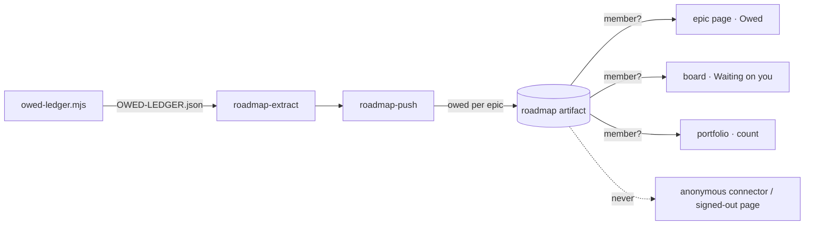

# Pitch — owed on screen

Moves · Tests: not grounded — an operator surface (see `grounded_reason`). Tests: Value proposition (the founder sees
what only they can do, without opening a file).

## The ask, as given

> we recently implemented a way to collect all owed items, but im not sure where is it written to. please let me know
> and also your suggestion where to surface it on the human GUI.
> — Daniel, 2026-10-14

### Claims
1. The owed items are visible in the console, not only in a file.
2. A person can tell where each one comes from.
3. It sits where a human already looks.

**Teach-back:** yes — "You want the owed checks on screen, where you already look, so you clear them instead of
finding them by accident." (Daniel approved the surfacing suggestion, 2026-10-14.)

## Problem

`scripts/owed-ledger.mjs` (#357) writes `Roadmap/00-ideas/OWED-LEDGER.md/.json`: 83 open on 2026-10-14. Of those, 24
are judgments only the product owner can give (mostly `_Intent_` words), 7 are production credentials and 2 are npm
publishes. Only `standup.mjs` and `weekly-recap.mjs` read the file; no screen does. Daniel asked where it is written,
which is the finding: an owner who has to ask where their to-do list lives doesn't clear it.

## Appetite

M: two sprints. Data and the access rule first, then the three screens.
quote: $15–34 (M, n=24, p25–p75)

## Outcome & signal

A member opening an epic in the Hub sees its owed checks, and the board shows one "Waiting on you" band across epics,
split by who can clear each check. The open count is read from the ledger at the read date.

## Stage-2.5 bucket

Light enhancement on existing rails: the ledger, the roadmap push and the Hub pages all exist. New: one push field,
one member-only read, three renderings.

## Bill of materials (What / Why)

| What | Why |
|---|---|
| `owed` per epic in the roadmap extract + push schema | the Hub only knows what the push carries |
| one member-only read seam | the golden-frijoles roadmap is public; customers' repos aren't |
| connector + public scrub drop `owed` | an anonymous reader never gets it |
| epic page "Owed" section | the check, its kind, its source line |
| board "Waiting on you" band | one place, split: only you · an agent could |
| portfolio card count | the cross-product glance |
| `hub.owed_enabled` flag + `owed_viewed` | ship dark, know if it's used |

## Scope

**In v1:** `roadmap-extract.mjs` reads `OWED-LEDGER.json` and attaches each item to its epic by path (items in a
retro or sprint doc under an epic folder; anything else, like specs, goes to a project-level list). The push schema
gets nullish `owed` per item and a project-level `owed_unattached`, each bounded. One read function returns owed rows
only to a project member (`lib/membership.ts`) and an empty list otherwise. Renderings: the epic page section, the
board band (only you = judgment, credential, publish, ops; an agent could = signed-in, interactive; unsorted shown
under its own name), and the count on the portfolio card.
**Out of v1 (no-gos):** clearing a check from the screen (it's cleared where it was written: `✅` or `~~` on its line,
then regenerate); any connector tool for owed (agents already read the file in the repo); a new table (it rides the
push); the Tasks page (its bands are signal-derived tasks with a claim/resolve lifecycle).

## Rabbit holes

- **The public project.** Rule #2: golden-frijoles' roadmap is public, and the connector serves the horizon and epics
  to an anonymous reader (`app/api/v1/public/mcp/c/[token]/route.ts`). `owed` must be stripped in every read that
  isn't member-gated, ideally by the one read seam that hands it out. A spec asserts the anonymous connector and the
  signed-out epic page never carry an owed line.
- **"Signed in" is not "member".** The report page gates on `getSessionUser()` alone. For the public project, any
  signed-in stranger passes that check. Owed uses membership.
- **The repo is public anyway** for golden-frijoles, so for us this is hygiene. It matters for customers, whose repos
  are private and whose ledger lines name people and internal ids.
- **Bound the payload.** 83 lines today; cap per epic and in total (the push has `max()` on every field), and say "and
  N more" rather than truncate silently.
- **Staleness.** The ledger is as fresh as the last push from `main`. Show the push's freshness line the Hub already
  renders (`hub-freshness.ts`), never "live".

## What already exists (reuse, don't rebuild)

- `scripts/owed-ledger.mjs` and its JSON (kind, category, file, line, text). `scripts/roadmap-extract.mjs` →
  `scripts/roadmap-push.mjs` → `POST /api/v1/roadmap/push` → `lib/roadmap-artifact-schema.ts` (nullish additive
  fields, like `quote_*` and `verdict`).
- Hub pages: `app/hub/[projectSlug]/epic/[epicSlug]/` (gated by `requireDashboardAccess`), `app/hub/[projectSlug]/board`,
  `app/app/portfolio`.
- `design-system/bands` (`Band`, `TaskLine`, `BandEmpty`), `lib/hub-freshness.ts`, `lib/membership.ts`,
  `lib/public-connector-scrub.ts`.
- Flags: `lib/gates.ts` / the catalog (rule #6); `trackSelfEvent` for `owed_viewed`.

## Visuals



```surface
state: board-owed-success
route: /hub/golden-frijoles/board
- band "Waiting on you" sub "Only you can clear these. From the repo, pushed 2h ago."
- line "Answer the _Intent_ word · build-view-upgrade" meta "judgment · RETROSPECTIVE.md:4"
- line "Mint the first share link · pod-report" meta "credential · RETROSPECTIVE.md:72"
- band "An agent could, with a smoke account" sub "Signed-in and interactive walkthroughs."
- line "Signed-in walkthrough · connect-page" meta "signed-in · sprint-1.md:88"
```

```surface
state: board-owed-empty
route: /hub/golden-frijoles/board
- band "Waiting on you"
- empty "Nothing is owed. Every check from the epics has been cleared."
```

## UX heuristics & rails check

- **CI guards covering this surface:** the design-system drift/ratchet guards (bands are kit components), the
  `owed-ledger --check` static gate, the semantic-lint `tenancy` rule (single-project reads).
- **Audits-lens findings that apply:** none found.
- **Design-language debt:** none expected; reuse `Band`/`TaskLine`.

## Kill-switch / runtime gate

Measure: `hub.owed_enabled`, an enablement flag in the golden-frijoles catalog, **off until you roll it out**, measured
by `owed_viewed` (a member sees a band or section with at least one item). Created by story S2.4 with
`frijoles flags create hub.owed_enabled --enablement --all-envs`. Read through `lib/gates.ts`; off renders the pages
exactly as today.

## Acceptance criteria

**Sprint 1: the data, member-only**
- **S1.1** (high): the extract attaches each ledger item to its epic and the push carries it; a push without `owed`
  still validates; an oversized list is refused by the schema, naming the field.
- **S1.2** (high): one read returns owed rows to a member and nothing to a non-member or signed-out reader; the
  anonymous connector and `public-connector-scrub` never emit an owed line (spec on the public project).

**Sprint 2: on screen**
- **S2.1** (low): the epic page shows an "Owed" section (text, kind, `file:line`), or nothing when none are owed.
- **S2.2** (low): the board shows "Waiting on you" grouped by who can clear it, with the freshness line, and an empty
  state.
- **S2.3** (low): the portfolio card shows the open count per product.
- **S2.4** (low): `hub.owed_enabled` created in every env, off in production, `frijoles flags get` prints `off vN`;
  `owed_viewed` fires once per view with items.
- QA: pure specs on the attach/group functions (`lib/`), api spec for the push and the scrub, a browser spec for the
  band on/off. Signed-in walkthrough owed to the product owner.

## Open risks / research

- Target decided 2026-10-14 (Daniel): 83 → 40 open checks, read 30 days after shipping. The portfolio count stays (decision b).

## Intent match

_Advisory and uncalibrated (intent-match D1, D3): it can add a step, never block one. Regenerate with `node scripts/intent-match.mjs <this seed> --write`._

```text
Intent match — Roadmap/00-ideas/seeds/owed-on-screen.md
  coverage in   0.88  (3 claims)
  coverage out  0.57  (7 criteria)
  clarity       0.78  (7 criteria)
  teach-back    1.00  (yes)
  agreement     pending  (the optional reader at the architecture lock)
  why story     0.68  (advisory, not in the total)
Total 81 / 100 — uncalibrated · signals: coverage in, coverage out, clarity, teach-back
Band: build (placeholder bands: 80 build · 60 resolve follow-ups · below 60 sketch or spike)
Gaps: none
Untraced (trace it to the ask or cut it):
  criterion 2 (0.36): "**S1.2** (high): one read returns owed rows to a member and nothing to a non-member or si…"
  criterion 5 (0.40): "**S2.3** (low): the portfolio card shows the open count per product."
  criterion 6 (0.36): "**S2.4** (low): `hub.owed_enabled` created in every env, off in production, `frijoles fla…"
```

<!-- intent-match: {"coverage_in":0.88,"coverage_out":0.566,"clarity":0.779,"teach_back":1,"total":81} -->
