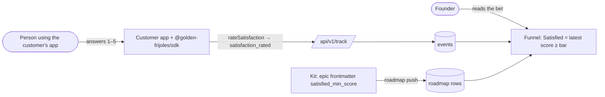

# Pitch — The Satisfied ask

Moves · Tests: neither moved directly — Tests: Value proposition (a founder "knowing with evidence" that a bet worked
includes whether the people who kept using it liked it). Not grounded: see `grounded_reason`.

## The ask, as given

> Refine the satisfied-ask idea in golden-frijoles

The ask is the raw seed (cut from `funnel-truth` at its Plan gate, 2026-10-14, carried from `tars-segments` item 3):

> A rating or a one-question survey the product can show (an SDK call plus a small UI the customer's app renders), which
> sends the bet's `satisfied_event`, and how the funnel reads it (a threshold, or any answer).

### Claims
1. The product can ask a person for a rating or a one-question answer.
2. An SDK call sends it as the bet's `satisfied_event`.
3. A small UI the customer's app renders.
4. The funnel reads it: a threshold, or any answer.
5. Someone decides who is asked and when (after retention, once per person).

**Teach-back:** yes — "You want the product to ask people whether a feature satisfied them, so the funnel's last stage
(Satisfied) gets real numbers instead of 'not measured'. Right?"

**Decisions at refine (Daniel, 2026-10-17):**
- **Size S, the customer draws the UI** (claim 3 becomes a README recipe, no component).
- **Satisfied = a score at or above a threshold**, and the threshold is **per bet** (`satisfied_min_score`, 1–5,
  default 4), not fixed.
- **The customer decides who is asked and when** (claim 5): an engine-decided "ask now?" route was proposed and
  dropped to hold S. The funnel only counts answers from retained people, so an early ask costs nothing in the numbers.
- **Miyagi counts as the second project** in the target.

## Problem

Satisfied already exists: `computeFunnel` counts a retained person who sent `satisfied_event` after adopting. But nothing
in the product *asks*, so no one has ever set it: every shipped epic's `satisfied_event` is `null`, ours included. A
team that wants it has to invent an event and a payload, and the read only checks the event's name, so a 1-star answer
counts as satisfied.

## Appetite

**S.** A standard send, a scored read with a per-bet bar, the contract field that carries the bar, and our own use of it.
quote: $8–20 (S, n=12, p25–p75)

## Outcome & signal

After this ships a founder calls `gf.rateSatisfaction({ flagKey, userId, score })` from their own prompt, sets
`satisfied_event: satisfaction_rated` (and optionally `satisfied_min_score`) on the bet, and its funnel shows a Satisfied
rate that counts only scores at or above the bar. The product owner tests it on Golden Frijoles' own funnel-trend bet,
then on Miyagi's.

## Stage-2.5 bucket

**Light enhancement.** Already possible today in its weakest form (`track('my_rating')` + `satisfied_event: my_rating`,
any answer counts); this adds the standard event, the score and the per-bet bar.

## Bill of materials (What / Why)

| What | Why |
|---|---|
| `satisfaction_rated` standard event (score 1–5 in `tags.score`, `featureId` = the flag key) | One name and payload the read can trust |
| SDK `rateSatisfaction({ flagKey, userId, score })` + `SATISFACTION_RATED_EVENT` (add-only) | Sending it right is one call, validated client-side |
| `satisfied_min_score` on a bet (1–5, null = 4) in the push contract, both sides | Each bet sets what "satisfied" means |
| Funnel reads the score: on the standard event, latest score ≥ the bar counts | "Any answer" counts unhappy people as satisfied |
| Gate `bets.satisfaction_ask_enabled` (a `GATES` row) on our console prompt | Measure our own use; switch the prompt off fast |
| Dogfood: the console asks members about funnel trends | Proof-of-use on our own bet first |
| SDK README recipe (draw your own prompt, ask after the person retained) | Claims 3 and 5 met without a component or a route |

## Scope
**In v1:** everything in the table.
**Out of v1 (no-gos):**
- A drop-in UI component or a new package.
- An engine-decided "ask now?" route (cut to hold S). Re-seed it if customers ask the wrong people.
- Free-text answers, NPS, multi-question surveys, survey analytics screens.
- Asking about registry features (`tars-query.ts` keeps `satisfiedEvent: null`): flags' bets only.
- Any change to a bet whose `satisfied_event` is a custom event: it reads exactly as today (any answer), and
  `satisfied_min_score` is ignored for it.

## Rabbit holes
- **The bar crosses the push contract**, which lives on both sides: the kit (`skills/…/vendor/lib/roadmap-contract.mjs`,
  `roadmap-extract.mjs`, `scaffold-epic.mjs`, `templates/scope-seed.md` + `epic-README.md`) and the app
  (`roadmap-artifact-schema.ts`, `hub-board.ts`). The kit side is a **plugin release** (`skills/RELEASING.md`). The field
  is optional and nullish on both sides, so an older pusher stays valid; the app must ship first or together.
- **One funnel model** (rule #1): the score read is a branch inside `computeFunnel`, not a second query.
- **The score lives in `tags`**: `readMeasureEvents` adds `tags->>score` to its select; `FunnelEvent` gains an optional
  `score`. No migration. A person who answers twice counts by their latest answer after adoption.
- **SDK surface is frozen at 0.6.0, add-only** (`surface-freeze.test.ts`): new exports only.
- **Our console is a customer of itself**: the dogfood prompt sends through the real SDK client (rule #1), never a
  direct insert.

## What already exists (reuse, don't rebuild)
- `apps/web/lib/flag-funnel.ts` → `computeFunnel` (the Satisfied stage), `FunnelMeasure`.
- `apps/web/lib/flag-funnel-read.ts` → `readMeasureEvents` (already fetches `satisfiedEvent`).
- `apps/web/lib/hub-board.ts` → the bet's measure from the pushed row (`satisfiedEvent` today).
- `apps/web/lib/roadmap-artifact-schema.ts` → `satisfied_event` already accepted; the bar sits beside it.
- The kit's `roadmap-contract.mjs` already carries `satisfied_event` (line ~180, ~200): the bar follows the same path.
- `apps/web/lib/gates.ts` + `gates-decision.ts → GATES`; `packages/sdk` `track` + `surface-freeze.test.ts`.
- `apps/web/lib/event-catalog-query.ts` already lists a bet's satisfaction event.

## Visuals



Three real-looking rows of the standard event:

| event | user_id | feature_id | tags |
|---|---|---|---|
| `satisfaction_rated` | `u_8f2a` | `bets.funnel_trend_enabled` | `{"score": 5}` |
| `satisfaction_rated` | `u_31c9` | `bets.funnel_trend_enabled` | `{"score": 2}` |
| `satisfaction_rated` | `u_31c9` | `bets.funnel_trend_enabled` | `{"score": 4}` |

(With the default bar of 4, `u_8f2a` and `u_31c9` both count: `u_31c9`'s latest answer is 4.)

The dogfood prompt in the console, under the funnel trend:

```surface
state: funnel-trend-ask-idle
route: /app/flags/bets.funnel_trend_enabled
- text "Did the funnel trend help you judge this bet?"
- actions "1" "2" "3" "4" "5" "Not now"
```

## UX heuristics & rails check
- **CI guards covering this surface:** `surface-freeze.test.ts` (SDK add-only), `gates-guard.test.ts`, the skills-ci
  split for the kit side, `scaffold-epic.test.mjs`, the design-system rails for the dogfood prompt.
- **Audits-lens findings that apply:** none found for satisfaction.
- **Design-language debt:** none; the prompt uses the kit's existing buttons.

## Kill-switch / runtime gate (Stage 6b)
- **Measure:** yes. Enablement flag `bets.satisfaction_ask_enabled` (a `GATES` row; `frijoles flags create
  bets.satisfaction_ask_enabled --enablement --all-envs`; `frijoles flags get` must print `on vN`/`off vN` in production)
  gating the console prompt. Adoption: `satisfaction_rated`; target 0 → 2 projects (Golden Frijoles + Miyagi).
- **Safety:** the same flag hides the prompt. `rateSatisfaction` is plain `track` and needs no gate.
- Switch per environment: on in development and preview at merge; production on after the dogfood smoke.

## Acceptance criteria

**Sprint 1 — the send, the bar, the read**
- S1.1 (low) `rateSatisfaction` sends `satisfaction_rated` with `featureId` = flag key and `tags.score`; a score that is
  not an integer 1–5 is refused client-side with a typed error; `SATISFACTION_RATED_EVENT` is exported;
  `surface-freeze.test.ts` still passes. Spec: SDK unit tests.
- S1.2 (**high**: the push contract, shared by kit and app) `satisfied_min_score` (integer 1–5, nullish) is accepted by
  `roadmap-artifact-schema.ts`, carried by `hub-board.ts` into the measure, and emitted by the kit's contract, extractor,
  scaffolder and both templates; an older push without it stays valid; out of range is refused with a clear message.
  Plugin release per `skills/RELEASING.md`. Specs: schema cases, `scaffold-epic.test.mjs`, the contract's own tests.
- S1.3 (low) A bet whose `satisfied_event` is `satisfaction_rated` counts retained people whose latest score after
  adoption is at or above its bar (null = 4); a custom event counts as today and ignores the bar. Spec: pure cases in
  `flag-funnel.test.ts` (5, 2, 2-then-4, bar 3, bar 5, custom event, no score).
- S1.4 (low) The console asks Golden Frijoles members about funnel trends through the real SDK, behind the gate, hidden
  after an answer or "Not now"; `funnel-truth`'s bet sets `satisfied_event: satisfaction_rated`. Browser smoke owed by
  Daniel (signed in).
- S1.5 (low) The SDK README gains the recipe: when to ask (after the person retained), the prompt you draw, the call, and
  the two bet fields. One plain-HTML example.

## Open risks / research
- Miyagi is the second project in the target and needs a Miyagi-side change (not in this repo), so the target may read
  1 of 2 on the read date. Named, not hidden.
- 4 of 5 as the default bar follows the common top-two-box reading of a 5-point scale (CSAT).
- S appetite with a plugin release inside it is tight; if it runs over, S1.5 (docs) moves to the close-out.

## Intent match

_Advisory and uncalibrated (intent-match D1, D3): it can add a step, never block one. Regenerate with `node scripts/intent-match.mjs <this seed> --write`._

```text
Intent match — Roadmap/00-ideas/seeds/satisfied-ask.md
  coverage in   0.69  (5 claims)
  coverage out  0.82  (5 criteria)
  clarity       0.86  (5 criteria)
  teach-back    1.00  (yes)
  agreement     pending  (the optional reader at the architecture lock)
  why story     0.32  (advisory, not in the total: rewrite the Why as a story)
Total 84 / 100 — uncalibrated · signals: coverage in, coverage out, clarity, teach-back
Band: build (placeholder bands: 80 build · 60 resolve follow-ups · below 60 sketch or spike)
Gaps:
  claim 3 — uncovered (0.14): "A small UI the customer's app renders." → wireframe
```

<!-- intent-match: {"coverage_in":0.688,"coverage_out":0.82,"clarity":0.861,"teach_back":1,"total":84} -->
