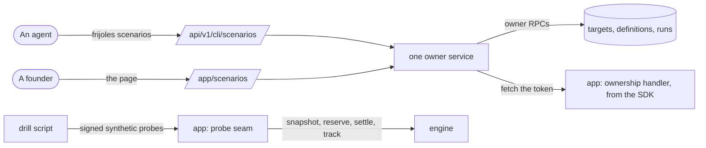

# Pitch — Scenarios, switched on

Moves · Tests: not grounded — a launch fix (the landing and the Measure menu promise drills, and all four switches are
off in production). Tests: Value proposition (the agent does the legwork).

## The ask, as given

> 3. **D6 is reversed: scenarios and drills stay and are switched on.** `scenarios-freeze` is dropped. The switches are
> already Golden Frijoles catalog flags (`ops.resilience_scenarios_enabled`, `ops.security_simulations_enabled`,
> `ops.scenario_authoring_enabled`, AGENTS rule 6), and the scenario definitions point at a fault-injector flag version
> in Golden Frijoles' own registry (`scenarios-pm-operable` README). The light-up is a chore, not a flip: the epic's
> own rule is "flip per environment only after a synthetic-cohort run has been verified end to end, including the
> kill path"; its high-risk fresh review is still owed; its one production target is revoked; and the epic is 10/10
> but never closed. The SDK scenario API stays (not deprecated), and so does the Measure entry.

(launch-sweep-2026-10-08, decision 3.) Then, 2026-10-13, at the Plan gate: "a. goldenfrijoles.com, c. yes, approve the
plan", and on the target gap:

> option 1, the important part is that agents are able to use the whole feature seamlessly. humans will use the gui
> but the idea is for agents to do it , lets ensure cli, sdk and or any other integration is first class for this work

### Claims
1. Scenarios and drills stay, and are switched on in production.
2. Switched on only after one synthetic run is verified end to end, including stopping it.
3. The owed high-risk fresh review happens.
4. A production target exists again: goldenfrijoles.com.
5. `scenarios-pm-operable` is closed.
6. The SDK scenario API and the Measure entry stay.
7. A founder can set up a target from the page (option 1).
8. An agent can do the whole feature: the CLI, the SDK and any other integration are first class; the page is for
   humans.

**Teach-back:** yes — "You want scenarios on at launch, but only once one real drill has been started and stopped
safely in production, so the promise on the landing is true." (Plan gate, 2026-10-13.)

## Problem

The landing and the Measure menu offer drills, but all four switches are off in production (`frijoles flags get`,
2026-10-13). Switching them on would not make drills usable:

- **Only Miyagi can make an app a target.** Registration and verification live only on `POST /api/v1/scenarios/admin`,
  which needs a `flag_admin` key (no command or page makes one: "minted from a database session") and a Miyagi user
  header (`isVerifiedMiyagiActor`). The scenarios page can only say "waiting on target verification".
- **An agent has nothing to call.** The CLI has no scenario commands, the connector no scenario tool, and the SDK no
  way for an app to answer the ownership check (the proof code is server-only, `lib/scenario-target-proof.ts`).
- **No app is a target.** The only target is revoked and belongs to another project.

## Appetite

L — grown from M at the Plan gate when the target gap was found; the product owner chose the full fix (option 1) and
named agents as the first user.
quote: $56–79 (L, n=5, p25–p75)

## Outcome & signal

After: an agent, using only `frijoles` and the SDK, makes goldenfrijoles.com a verified target, defines a `delay`
drill on a fault flag, launches it, watches it run and stops it, in production. A founder can do the same from the
scenarios page. The three switches are on. Tested by an agent run recorded in the PR, then the product owner's
walkthrough on the page.

## Stage-2.5 bucket

light-enhancement on the engine (definitions, runs, stop, impact, owner launch/stop are built), genuinely new on the
agent side (target setup for anyone, CLI, SDK helper, connector tool).

## Bill of materials (What / Why)

| What | Why |
|---|---|
| Owner target setup: register → one-time token → verify | anyone can make their app a target, not only Miyagi |
| The app proves itself by returning the token at its ownership path | no shared secret to store or leak; the proof is controlling the origin |
| SDK: an ownership handler | an agent adds one line to the app instead of hand-rolling a proof |
| CLI: `frijoles scenarios …` (targets, define, launch, stop, runs) | the agent does the whole drill from the terminal |
| One owner service behind the page and the CLI | one path, one set of rules, both surfaces |
| Connector: a scenarios read tool | an agent in claude.ai can see runs and stop reasons |
| Our site as the first target, a probe and a drill script | the drill needs an app that takes the fault; ours is the public project |
| The drill, run by an agent in production; you stop one from the page | the old epic's rule before switching on |
| Your read of the impact comparison | D11: "looks good" is a warning sign |
| Three switches on; breakers stay off; old epic closed | the decision |

## Scope

**In v1:** owner target register/verify (page, CLI, owner RPCs); the SDK ownership handler; `frijoles scenarios`;
a connector read tool; the plugin's agent docs naming the commands; goldenfrijoles.com as a target with a probe and a
drill script; the production drill; three switches on; `scenarios-pm-operable` closed; the fresh review.

**Out of v1 (no-gos):**
- Any security drill in production (needs `production_security` approval, D9); its switch only shows the surface.
- External cohorts (D10 stands) and automatic circuit breakers (stay off).
- Connector WRITE tools (the connector stays read-only; agents write through the CLI).
- A chart for impact (#14 stays open).
- Changing Miyagi's credential route or its proof contract.

## Rabbit holes

- **The proof.** The token is shown once and stored only as a hash (the column registration already writes). The app
  returns it at `/api/internal/resilience/ownership`; the engine fetches it through the existing guarded fetch,
  hashes it and compares. A token someone else reads is useless to them: verifying needs the project's owner.
- **The probe must never touch a visitor.** It answers only a request signed with a server secret, only for a
  `synthetic:` subject; anything else is 404, whatever the switches say.
- **The authoring switch is global**, and its controls are owner-only. If a stop fails,
  `frijoles flags kill ops.scenario_authoring_enabled` (≈30 s) and the run's duration cap end it.
- **Releases.** SDK and CLI ship as new minor versions; npm publish is the product owner's 2FA step.

## What already exists (reuse, don't rebuild)

- Owner page and actions: `app/app/scenarios/[projectSlug]/` (define, launch, stop, revoke).
- Owner RPCs and cores: `supabase/migrations/20260813100000_scenario_owner_operations.sql`
  (`private.assert_scenario_owner`, `owner_*`); registration and verification in `20260809110000`.
- Target proof and guarded fetch: `lib/scenario-target-proof.ts`, `lib/scenario-admin-operations.ts`.
- CLI auth: `lib/cli-auth.ts` (`requireCliOwner`, `requireCliMember`); CLI commands in `packages/cli/src/commands/`;
  JSON flags via `frijoles flags create --type json --variants`.
- Runtime: `createScenarioProvider`, `trackScenarioExecution` (`packages/sdk`).
- Connector tools: `lib/mcp-flag-tools.ts` (the pattern for a read tool).

## Visuals



## UX heuristics & rails check
- **CI guards covering this surface:** `scenario-dark.spec.ts`, `scenario-dashboard.authed.spec.ts`,
  `gates-guard.test.ts`, `mcp-flag-parity.test.ts` (the pattern), the CLI golden tests, the semantic-lint `tenancy` rule.
- **Audits-lens findings that apply:** launch-sweep §8; CLI-first for agent surfaces (the agent fetching is the value).
- **Design-language debt:** none new; the target panel uses the page's existing primitives.

## Kill-switch / runtime gate

Existing enablement gates: `ops.scenario_authoring_enabled` (every write: page and CLI), `ops.resilience_scenarios_enabled`
and `ops.security_simulations_enabled` (execution). Kill: `frijoles flags kill <key> --env production`. Measure: not
measured — the drills record their own runs, and no adoption event exists yet (a carve-out, said here).

## Acceptance criteria

- **Targets:** an owner registers an origin and gets a token once; the app serves it; verify marks the target
  verified; a wrong or missing token fails with a plain reason; a non-owner gets "not found"; Miyagi's route is
  unchanged.
- **SDK:** `createScenarioOwnershipHandler({ token })` answers the ownership path and nothing else; documented.
- **CLI:** `frijoles scenarios targets add|verify|revoke`, `define`, `launch`, `stop`, `ls`/`runs`, each with `--json`;
  owner-only writes, member reads; every write needs the authoring switch.
- **Connector:** a scenarios read tool lists definitions and runs with their state and stop reason.
- **Our site:** the ownership handler is live; the probe answers only signed synthetic requests; the drill script
  sends N probes and prints what each got.
- **The drill:** done by an agent through the CLI in production: target verified, `delay` drill defined, launched,
  seen running, stopped, terminal with its stop reason, no breaker trip. The product owner stops a second run from
  the page and judges the impact comparison.
- **Switched on:** resilience, security and authoring `true` in production; breakers off; `scenarios-pm-operable`
  closed; the poster says drills are live.

## Open risks / research

- The probe's signing secret and the flag-read key for golden-frijoles are production credentials in Vercel env
  (rule #4: a commit to `main` lands them). The product owner approved making them headlessly (2026-10-13).

## Intent match

_Advisory and uncalibrated (intent-match D1, D3): it can add a step, never block one. Regenerate with `node scripts/intent-match.mjs <this seed> --write`._

```text
Intent match — Roadmap/00-ideas/seeds/scenarios-light-up.md
  coverage in   0.91  (8 claims)
  coverage out  0.85  (7 criteria)
  clarity       0.75  (7 criteria)
  teach-back    1.00  (yes)
  agreement     pending  (the optional reader at the architecture lock)
  why story     0.40  (advisory, not in the total: rewrite the Why as a story)
Total 87 / 100 — uncalibrated · signals: coverage in, coverage out, clarity, teach-back
Band: build (placeholder bands: 80 build · 60 resolve follow-ups · below 60 sketch or spike)
Gaps: none
```

<!-- intent-match: {"coverage_in":0.905,"coverage_out":0.846,"clarity":0.748,"teach_back":1,"total":87} -->
