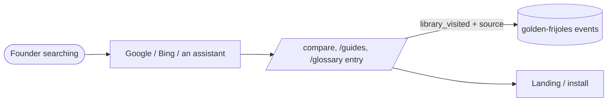

# Pitch — SEO library, batch 2

Moves: proving_landing_workspaces · Tests: Growth strategy

## The ask, as given

> what about the seo pages? yes i want to do the video cuts as well but want to see some other suggestions besides the post mortem, i wouldnt consider it remarkable at all. lets find features or whatever other angles you have

Then, choosing between the scripts and the next ten pages: "c, both".

### Claims
1. Grow the SEO pages beyond the first batch.
2. (Video angles: answered outside this epic, in `traffic-relaunch/video-wave-1.md`.)

**Teach-back:** yes — "You want the next pages to target searches founders already type, so search brings visitors on its own. Right?" ("c, both")

## Problem
The library has 11 pages (traffic-relaunch S2). Each targets a cluster, but none targets the specific searches Google
autocompletes today: "spec kit alternatives", "posthog alternatives self hosted", "claude code plugin marketplace",
"spec driven development qué es". Spanish searches for our topics have thin competition and nothing from us. Baseline
before the outage: 2–4 landing visits a day once the launch faded (our own counter, 26–29 Oct).

## Appetite
S — one sprint, content-led. The module, routes, sitemap, llms.txt and JSON-LD already exist; this adds entries and a
`lang` field.
quote: $8–19 (S, n=13, p25–p75)

## Outcome & signal
Ten more pages live, indexed and listed; two in Spanish, marked `lang="es"` with a matching hreflang alternate where an
English twin exists. Signal: `events count library_visited --by slug` shows visits to the new slugs, and `--by source`
shows `google.com` / `bing.com` among them within 4–6 weeks.

## Stage-2.5 bucket
**Light enhancement.** Ten entries in `lib/content-library.ts` plus one optional field (`lang`). No new routes.

## Bill of materials (What / Why)

| What | Why |
|---|---|
| compare/spec-kit-alternatives | Autocompleted, plus "…reddit": people are actively choosing |
| compare/posthog-alternatives-self-hosted | "posthog alternatives open source / self hosted" — switching intent |
| compare/growthbook-alternatives | Autocompleted; we do flags + A/B too |
| guides/claude-code-plugin-marketplace | "claude code plugin marketplace" — where our install lives |
| guides/spec-driven-development-claude-code | Autocompleted; the bridge from spec to outcome |
| guides/agentic-product-management-tools | "agentic product management tools / course" — our category |
| guides/feature-flags-for-solo-founders | "feature flags for …" — the persona's own words |
| glossary/feature-adoption-rate | "how to measure feature adoption rate" |
| guides/spec-driven-development-que-es (es) | "spec driven development qué es / español" — thin competition |
| guides/north-star-metric-ejemplos (es) | "north star metric ejemplos / español" |
| `lang` on an entry → `<article lang>` + hreflang | Search engines serve the Spanish page to Spanish searchers |

## Scope
**In v1:** the ten entries; an optional `lang: 'es'` field rendered as `<article lang="es">` and an `alternates.languages`
hreflang where a twin exists; sitemap + llms.txt pick them up as they already do.
**Out of v1 (no-gos):** no `/es/` route tree or translated chrome (the frame stays English); no keyword-volume ranking (it
waits for the Bing / Keyword Planner accounts); no `/verdicts` pages; no claims about other tools that we can't source.

## Rabbit holes
- **Fairness and dates on comparisons.** Every competitor claim is sourced to that vendor's own site, dated, and hedged
  ("check their site for current plans"). A claim we can't source is cut.
- **Spanish quality.** Written natively, not machine-literal; Daniel reads both.
- **`html lang` stays `en`.** The root layout sets it; a per-article `lang` is the honest, contained signal. A full i18n
  tree is a later epic, if Spanish proves out.

## What already exists (reuse, don't rebuild)
- `lib/content-library.ts` (entries, `entriesIn`, `findEntry`), `components/library/LibraryPages.tsx`, the six routes.
- `lib/content-jsonld.ts` + its spec (it validates every new entry automatically).
- `lib/public-routes.ts` / `app/sitemap.ts` / `app/llms.txt` (they list every entry automatically).
- `e2e/library-routes.spec.ts` (every entry 200 + JSON-LD + listed), `design-system/route-manifest.ts` (routes unchanged).
- `library_visited` (D11) already tags section, slug and source.

## Visuals



## UX heuristics & rails check
- **CI guards:** content-jsonld.test (every entry), library-routes.spec, methodology-agent-readable (sitemap + llms.txt).
- **Audits-lens findings:** the readability-pass rule: each page says its answer once, first.
- **Design-language debt:** none; same frame and prose as batch 1 (deferred design approval already owed to Daniel).

## Kill-switch / runtime gate
Not needed (risk low, content only). Rollback is `git revert`.

## Acceptance criteria
**S1 · Ten pages for searches founders already type**
- 1.1 (low) The eight English entries are live: each opens with its answer, carries FAQ or DefinedTerm JSON-LD, and is in
  the sitemap and llms.txt. Every competitor statement is sourced and dated.
- 1.2 (low) The two Spanish entries are live with `<article lang="es">`; the English twins (where one exists) carry an
  hreflang alternate to them and back. A unit spec checks that every `lang: 'es'` entry renders its `lang` and its pair.
- 1.3 (low) Daniel reads the ten pages; the copy is approved before merge.

Smoke walkthrough owner: Daniel (read the pages; Search Console "Request indexing" on the two section indexes).

## Open risks / research
- Autocomplete shows that a search exists, not how often it happens; volumes wait for Daniel's Bing/Keyword Planner accounts.
- Competitor facts change; each comparison carries its `updated` date and is re-read quarterly.

## Intent match

_Advisory and uncalibrated (intent-match D1, D3): it can add a step, never block one. Regenerate with `node scripts/intent-match.mjs <this seed> --write`._

```text
Intent match — Roadmap/00-ideas/seeds/seo-library-batch-2.md
  coverage in   0.55  (2 claims)
  coverage out  0.80  (3 criteria)
  clarity       0.80  (3 criteria)
  teach-back    1.00  (yes)
  agreement     pending  (the optional reader at the architecture lock)
  why story     0.69  (advisory, not in the total)
Total 79 / 100 — uncalibrated · signals: coverage in, coverage out, clarity, teach-back
Band: resolve the follow-ups first (placeholder bands: 80 build · 60 resolve follow-ups · below 60 sketch or spike)
Gaps:
  claim 2 — uncovered (0.13): "(Video angles: answered outside this epic, in `traffic-relaunch/video-wave-1.md`.)" → copy deck
```

<!-- intent-match: {"coverage_in":0.55,"coverage_out":0.803,"clarity":0.804,"teach_back":1,"total":79} -->
