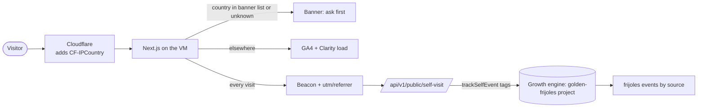

# Pitch — Traffic relaunch

Moves: proving_landing_workspaces · Tests: Growth strategy

## The ask, as given

> Hi claude help me get traffic to the site.
>
> We recently had an outage of the whole site for the weekend and lost some traction. Lets kickstart it again. Suggest overall strategy, all is on the table.
> Ive found that reels and tiktoks bring lots of traffic, we could explore there.
>
> Lets also ground the whole project seo strategy and optimize, please run some keyword research. Ive found this repo https://github.com/every-app/open-seo not sure if anything of help could be extracted from their primitives.
>
> In terms of cold out reach ive found this other project: https://github.com/warmbly/warmbly lets also see if anything useful.
>
> So drive from the top please, 360.

Then, on the measurement finding: "so why dont we just show it to eu and uk visitors but exclude mx and us and rest of the world?" — "yes include brazil and canada, start both".

### Claims
1. Restart traffic after the weekend outage.
2. Short-form video (Reels, TikTok) as a traffic channel.
3. Ground and optimise the site's SEO, with keyword research.
4. Judge open-seo for reusable primitives.
5. Judge warmbly for cold outreach.
6. Show the consent banner only in the EU/UK (plus Brazil and Canada); load analytics without it everywhere else.

**Teach-back:** yes — "You want the site found and credited again — video, search, outreach — so traffic recovers from the outage and we can see which channel brought it. Right?" (the deck, approved 2026-11-03: "everything else looks pretty tight")

Claims 2, 4 and 5 are answered outside this epic (the deck: https://claude.ai/artifact/Q8xZfceV5VCzZfbfKkoSLv). Video, outreach and the open-seo/warmbly verdicts are operations, not code. This epic is the code the campaign needs.

## Problem
The landing is fed by launches. When a launch fades or the site goes down, nothing refills it. Three facts, read 2026-11-03:
- **We can't see visitors.** GA4 and Clarity load only after an explicit yes (deny by default, everywhere), so Clarity recorded 4 sessions in 30 days. The first-party beacon counts every visit but records no source, so no channel can be credited.
- **Nothing to rank.** The sitemap lists 16 URLs: home, methodology, install, talk, legal, agent files. No page answers a question a founder types.
- **The privacy page is stale.** It still names Vercel as our host (we left it 2026-11-02).

## Appetite
M — two sprints. If the content sections cannot fit, the post-mortem page ships and the sections wait.
quote: $15–33 (M, n=28, p25–p75)

## Outcome & signal
After this ships: a visitor from Mexico or the US is counted by GA4 and Clarity with no banner; a visitor from Germany, the UK, Brazil or Canada sees the banner exactly as today; every `landing_visited` carries its source (`utm_source`/`utm_medium`/`utm_campaign`/`utm_content`, or the referrer's host); `/guides`, `/compare` and `/glossary` exist, are in the sitemap, and carry FAQ structured data; the outage post-mortem is a page. Signal: `frijoles` events grouped by source tag show non-direct sources within a week of the first videos.

## Stage-2.5 bucket
**Light enhancement** for Sprint 1 (the consent component, the beacon and the route all exist; this changes who sees the banner and adds tags). **Genuinely new** for Sprint 2 (content sections), built on the methodology's existing typed-content-module pattern.

## Bill of materials (What / Why)

| What | Why |
|---|---|
| Country from `CF-IPCountry`, read server-side, decides `consentRequired` | Only Cloudflare reaches the origin (Authenticated Origin Pulls), so the header can't be forged |
| Banner region list: EU/EEA, UK, CH, BR, CA, unknown → banner | The laws that require opt-in; unknown fails closed |
| Elsewhere: GA4 + Clarity load on marketing paths, no banner; footer "Cookie settings" still opts out | Count the 90%+ we lose today; keep the visitor's way out |
| Beacon sends UTM params + referrer host; route validates and tags them | Credit each video/search/community; tags are the query layer's groupable dimension |
| Privacy page: region rule + host fix (Vercel → our own server) | The page must say what the product does (`lib/legal.ts`) |
| `/guides`, `/compare`, `/glossary` from ONE typed content module | The methodology pattern: one author feeds pages, sitemap, llms.txt |
| FAQ JSON-LD on those pages | Search and AI assistants quote structured answers |
| Post-mortem page | The relaunch story, on our own domain |

## Scope
**In v1:** region-gated consent; source capture on the beacon; privacy page update; three content sections with a first handful of entries; FAQ schema; post-mortem page; sitemap + llms.txt entries.
**Out of v1 (no-gos):**
- No `/verdicts/*` case pages yet (they need proven bets to show; next epic).
- No Spanish-language pages yet (next epic, once keyword volumes are in).
- No geo-personalised content, no IP stored, no country written to events.
- No change to the marketing-path allow-list: Clarity never loads in the console, `/install` or share links.
- No CMS; content lives in the repo.
- No video, Buffer or outreach code.

## Rabbit holes
- **Caching.** The decision is per request; a cached HTML page carrying one country's choice to another breaks it. The landing is `force-dynamic` and Cloudflare does not cache HTML by default; the builder confirms the response is `cf-cache-status: DYNAMIC`/`BYPASS`, and the consent decision never goes into a cacheable response.
- **Where the decision is computed.** The consent component is a client component in the root layout; the country must come from the server (a prop from the layout, or a tiny server read), never from a client-side geo API.
- **Header trust off production.** Locally and in CI there is no `CF-IPCountry`: that reads as unknown → banner, which keeps the existing consent specs valid. Tests pass the header explicitly to exercise the no-banner path.
- **UTM as attacker input.** The route is unauthenticated: values are length-capped, charset-restricted, and the referrer is reduced to a host. Never a free-form string into a tag.
- **Content scope creep.** Three sections × a few entries, not 40 pages; the deck's 40 is the 90-day campaign, written by agents after the scaffold exists.

## What already exists (reuse, don't rebuild)
- `apps/web/components/consent/ConsentManager.tsx` — the banner, both loaders, the path gate. Gains one input: `consentRequired`.
- `apps/web/lib/consent.ts` — `analyticsAllowed()`; becomes `analyticsAllowed(stored, consentRequired)` with a pure region helper beside it (`lib/consent-region.ts`, unit-tested).
- `apps/web/lib/marketing-paths.ts` — unchanged.
- `apps/web/lib/analytics-ids.ts` — unchanged.
- `apps/web/components/landing/SelfTrackBeacon.tsx` → `apps/web/app/api/v1/public/self-visit/route.ts` → `lib/self-track.ts` `trackSelfEvent(…, tags)` — rule #1 path; tags already supported.
- `apps/web/lib/legal.ts` — privacy copy source of truth.
- `apps/web/lib/methodology-chapters.ts`, `lib/public-routes.ts`, `app/sitemap.ts`, `app/llms.txt` — the typed-content + sitemap pattern the new sections copy.
- `lib/site-url.ts` `getSiteUrl()` for every absolute URL (rule #5).
- `e2e/consent.spec.ts`, `e2e/consent.authed.spec.ts` — extend, don't replace.

AGENTS rules checked: #1 (tracking stays on `trackSelfEvent`), #2 (no public read path touched), #5 (URLs via `getSiteUrl`), #6 (no env-var gate added). No tenancy surface.

## Visuals



| country | banner | GA4 + Clarity | beacon |
|---|---|---|---|
| MX | no | load on marketing paths | landing_visited, source=tiktok |
| DE | yes | only after yes | landing_visited, source=google |
| (missing) | yes | only after yes | landing_visited, source=direct |

## UX heuristics & rails check
- **CI guards covering this surface:** `e2e/consent*.spec.ts`, `lib/gates-guard.test.ts` (no env gate), `e2e/positioning-surfaces.spec.ts`, the route sweep (mobile), the design-system rails for new pages.
- **Audits-lens findings that apply:** none found for consent; the readability-pass rule (say each thing once) applies to the content pages.
- **Design-language debt:** none known; new pages use the methodology's components.

## Kill-switch / runtime gate (risk:high only — Stage 6b)
**Carve-out: no flag.** Measure: the bet is measured by its North Star input and the source tags, not a rollout. Safety: the region rule's failure mode is a missing banner where one is required; the rollback is `git revert` (minutes, merge = deploy), and the rule fails closed on any missing or unknown country. Daniel's standing rule (2026-08-31): ship enabled, not dark.

## Acceptance criteria
**S1 · Count every visitor and its source**
- 1.1 (high) A request with `CF-IPCountry: MX` (and US, JP) to `/` renders no banner and loads GA4 + Clarity; `DE`, `FR`, `GB`, `CH`, `BR`, `CA`, `XX`, `T1` and no header render the banner and load nothing until yes. "Cookie settings" opens the banner everywhere; choosing no reloads without the scripts. Off marketing paths, nothing loads, whatever the country. Pure spec on the region helper; e2e on both paths.
- 1.2 (low) A visit to `/?utm_source=tiktok&utm_medium=video&utm_campaign=relaunch&utm_content=postmortem-1` records `landing_visited` with those four tags; a visit from a referrer records `ref_host`; values over 64 chars or outside `[a-z0-9._-]` are dropped, not stored. Same for methodology surfaces.
- 1.3 (low) The privacy page states the region rule and names the VM host, not Vercel; `legal.test.ts` updated.
- 1.4 (high — an authed read path) `frijoles events count <event> [--days N] [--by <tag>] [--json]` prints how many times an event fired in one project, per day, optionally grouped by a tag (e.g. `--by utm_source`). Member-gated like the other CLI reads (`lib/membership.ts`), single-project, read through `lib/event-catalog-query.ts` (rule #1: no ad hoc `events` query); a non-member gets "not found". Asked by Daniel 2026-11-03 ("the cli must have event count command") so the post-mortem's lost visits and every channel's credit can be read from a terminal. CLI release (npm publish, 2FA) owed to Daniel.

**S2 · Pages that answer questions**
- 2.1 (low) `/guides`, `/compare`, `/glossary` with index + entry pages, fed by one typed module; each entry is in `sitemap.xml` and `llms.txt`; first entries: 3 guides, 2 compares, 6 glossary terms (drafted from the deck's keyword clusters).
- 2.2 (low) Each entry page carries valid FAQPage JSON-LD (or DefinedTerm for the glossary); a unit spec validates the shape.
- 2.3 (low) The outage post-mortem is a page at `/guides/outage-2026-11` (inside the guides section: no new route), with the numbers Daniel approves (lost visits read with 1.4). Draft and three video cuts: produced 2026-11-03 in the planning session, Daniel decides naming the host.

Smoke walkthrough owner: Daniel (a phone in Mexico for the no-banner path; a VPN exit in Germany for the banner path).

## Open risks / research
- Opt-in for analytics cookies: GDPR + ePrivacy (EU/EEA), UK GDPR/PECR, Swiss FADP, Brazil LGPD, Quebec Law 25 (no province from IP → all of Canada). Mexico (LFPDPPP) and US states (CPRA: opt-out) do not require prior opt-in for analytics. Not legal advice; the region list is a constant, one edit to change.
- Clarity requires a consent signal for EEA/UK/CH traffic since 31 Oct 2025 (`consentv2`, already sent); outside the banner regions we send it as granted on load.
- Cloudflare's IP Geolocation (`CF-IPCountry`) is on by default; the builder verifies it reaches the origin in production.

## Intent match

_Advisory and uncalibrated (intent-match D1, D3): it can add a step, never block one. Regenerate with `node scripts/intent-match.mjs <this seed> --write`._

```text
Intent match — Roadmap/00-ideas/seeds/traffic-relaunch.md
  coverage in   0.56  (6 claims)
  coverage out  0.71  (6 criteria)
  clarity       0.85  (6 criteria)
  teach-back    1.00  (yes)
  agreement     pending  (the optional reader at the architecture lock)
  why story     0.32  (advisory, not in the total: rewrite the Why as a story)
Total 78 / 100 — uncalibrated · signals: coverage in, coverage out, clarity, teach-back
Band: resolve the follow-ups first (placeholder bands: 80 build · 60 resolve follow-ups · below 60 sketch or spike)
Gaps:
  claim 2 — uncovered (0.37): "Short-form video (Reels, TikTok) as a traffic channel." → copy deck
  claim 5 — uncovered (0.08): "Judge warmbly for cold outreach." → think chain (worth doing? run `pmf-narrative`, then `risk-validation`; any other trade-off, reason it in writing)
Untraced (trace it to the ask or cut it):
  criterion 3 (0.39): "1.3 (low) The privacy page states the region rule and names the VM host, not Vercel; `leg…"
```

<!-- intent-match: {"coverage_in":0.555,"coverage_out":0.713,"clarity":0.854,"teach_back":1,"total":78} -->
